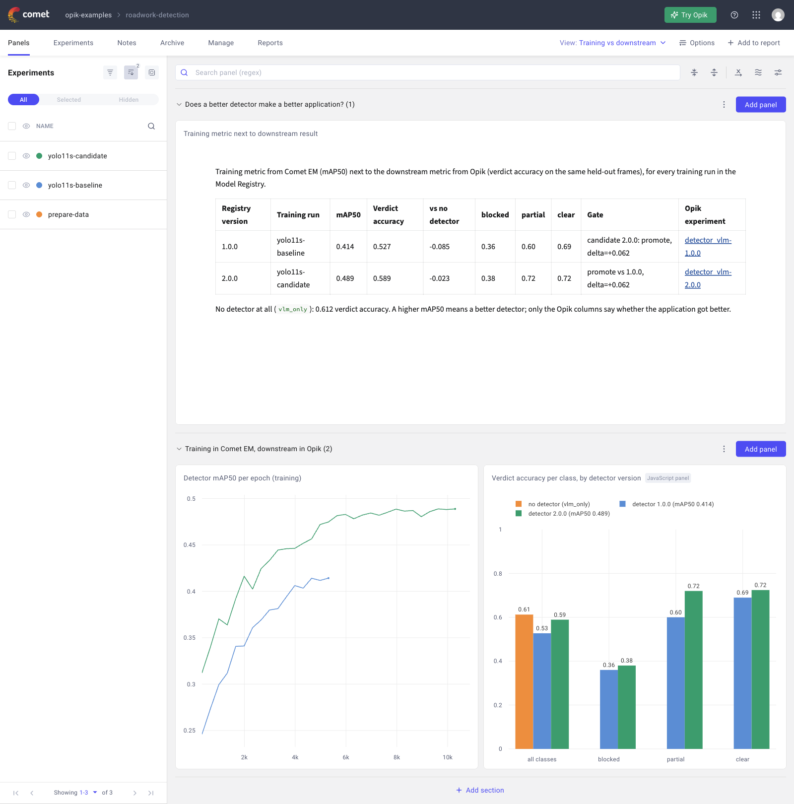
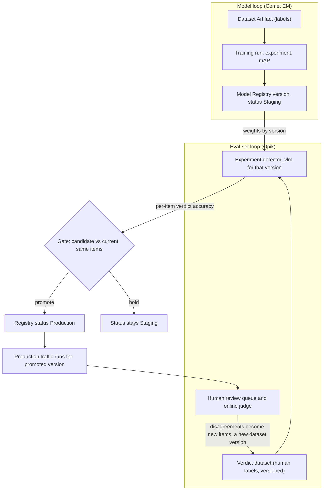
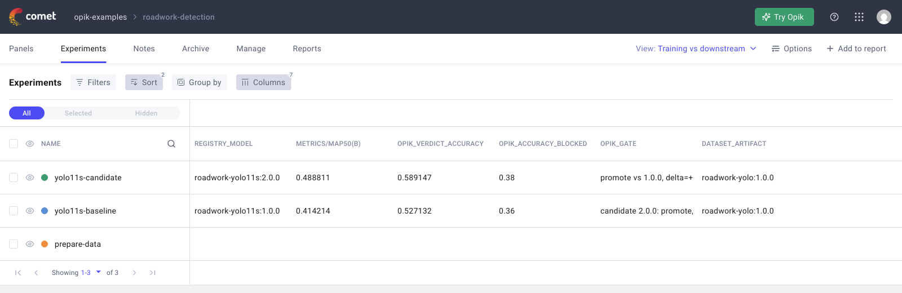
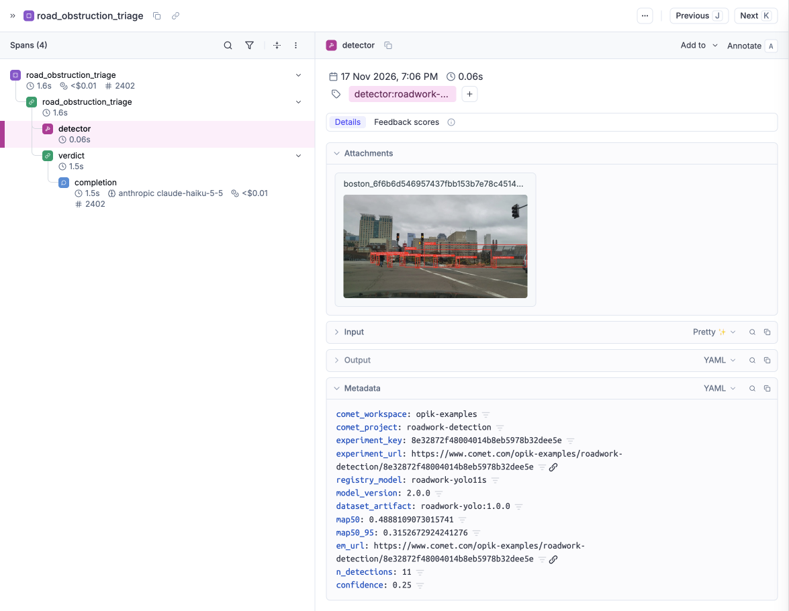

# From Comet Experiment Management to Opik: the Model Registry as the handoff

Fine-tune a detector in Comet Experiment Management (EM), evaluate the application built on it in
Opik, and let a gate decide which training run gets promoted. The only thing the evaluation side
needs from the training side is `workspace/model:version`.



*The Comet project view this guide builds. For every registered training run: the training
metric (mAP50), the downstream result measured in Opik, the gate decision and a link to the Opik
experiment.*

## What this does

A team that fine-tunes a model ends every training run with a training metric, here mAP. The
question they have to answer is a different one: did the application that uses the model get
better, and should this run replace the one in production? Answered by hand, that means copying a
weights path into an evaluation script, remembering which dataset and prompt the last evaluation
used, pasting numbers into a sheet and telling someone to switch the model. This guide wires that
path once, with Comet Experiment Management (EM) for the model side and Opik for the application
side: every training run ends with its downstream result next to its mAP, and with a recorded
promote-or-hold decision that production traffic follows.

### The use case

A vehicle camera flags a possible road blockage. A YOLO11 detector fine-tuned on work-zone
objects (cones, barriers, signs) and a vision-language model decide whether the road ahead is
`blocked`, `partial` or `clear`. Two pipeline variants are compared: `vlm_only` (the vision model
alone) and `detector_vlm` (the vision model also gets the detector's findings and an overlay
image). The detector is the part the team trains; the verdict is what the product ships.

### Why the training metric is not enough

In the run documented below, a second training run raised mAP50 from 0.414 to 0.489. Judged on
mAP alone, both fine-tunes are improvements. Downstream, the first one made the application
worse than using no detector at all (verdict accuracy 0.527 against 0.612), and the second one
only won part of that back (0.589). Nobody sees this in a training dashboard unless the
downstream result is brought there. That is what this guide does.

### Who answers what

| Question the team asks | Where the answer is | Put there by |
|---|---|---|
| Which data was this model trained on? | Comet Artifact lineage: one producer, every training run a consumer | `01_prepare_data.py`, `02_train.py` |
| Which model is deployed right now? | Comet Model Registry status (`Production` / `Staging`) | `03_register.py`, the gate |
| Is the application better with this model? | Opik experiments, one per model version, on one versioned dataset | `05_run_experiments.py` |
| Can I see that where I look at my training runs? | `opik_*` metrics on the Comet experiment, and the project view with a Python and a JavaScript panel | `05_run_experiments.py`, `10_em_dashboard.py` |
| Should it be promoted, and who decided? | Gate output, `opik_gate` on both training experiments, registry status | `python -m roadwork_demo.gate` |
| What runs in production, and is it still good? | Opik traces tagged with the registry version, an online judge, a human review queue | `06` to `09` |

### Three ideas

1. **The Model Registry is the contract.** The Opik side is given a registry version (or the
   status `Production`) and resolves everything else through the Comet API: the training
   experiment, its dataset Artifact, its mAP. There is no handoff file to keep in sync.
2. **Model version is an axis of the Opik experiments.** The same verdict dataset is run against
   the stock detector, registry version 1.0.0 and a second training run, 2.0.0. The results are
   written back onto each training experiment, so Comet EM shows mAP next to downstream accuracy.
3. **A gate promotes or holds.** It compares two Opik experiments item by item and, on a promote,
   changes the registry status. New traffic follows the status with no config edit.

### Two loops that meet at the gate



Human review produces verdict labels, not boxes. So reviewed disagreements improve the Opik
verdict dataset (right loop); they do not become detector training labels. Detector retraining is
driven from the left loop: a new dataset Artifact version or a new training config. The loops
meet at the gate, which needs both a registered model and an experiment on the current dataset.
This guide runs the left loop twice and the gate once. The step "reviewed disagreements -> new
dataset version" is described here, not scripted.

### One set of identifiers in both products

| Identifier | Where it shows in Comet EM | Where it shows in Opik |
|---|---|---|
| Registry model and version | Model Registry page, with status and source experiment | Trace tag `detector:<model>:<version>`, detector span metadata, experiment configuration, experiment name `detector_vlm-<version>` |
| Training experiment key and URL | The experiment itself | Trace and span metadata (`experiment_key`, `em_url`), experiment configuration |
| Dataset Artifact version | Artifact lineage: `prepare-data` produces it, every training run consumes it | Experiment configuration (`dataset_artifact`) |
| Opik experiment, dataset version and scores | Experiment "Other" and "Metrics" tabs (`opik_experiment_url`, `opik_dataset_version`, `opik_verdict_accuracy`, `opik_accuracy_<class>`), HTML tab with a clickable table | The experiment itself |
| Gate decision | Registry status (`Production` / `Staging`), `opik_gate` on both training experiments | Trace tags of new traffic follow the Production version |

The pipeline loads its weights from the Model Registry, not from the local training folder, so
what Opik evaluates is what the registry serves. `vlm_only` runs no detector: its experiment
exists once and its traces carry no detector identity.

## Prerequisites

```bash
uv sync --extra detector
```

`uv sync` alone installs everything except Ultralytics and torch; that is enough for the tests
and the dry run. Without `uv`: `pip install -e ".[detector]"` from this folder.

You also need a Comet account (EM and Opik in one workspace), an API key for the verdict and
judge models, and about 25 GB of free disk. Training runs on an Apple Silicon GPU by default
(`--device mps`); pass `--device 0` for CUDA or `--device cpu`.

| Environment variable | Required | Description |
|---|---|---|
| `COMET_API_KEY` | for every step except 4 | Comet EM, Artifacts and Model Registry. The Opik-side scripts need it too: they resolve the detector through the registry. Unset -> steps 1-3 print a `[DRY RUN]` line and stop |
| `OPIK_API_KEY` | for steps 4-7 and 9-11 | Opik. Unset -> those scripts print a `[DRY RUN]` line and stop |
| `COMET_WORKSPACE`, `OPIK_WORKSPACE` | yes | The same workspace for both products |
| `ANTHROPIC_API_KEY` (or the key for your model provider) | for steps 5, 6, 9, 11 | Verdict and judge models, called through litellm |
| `OPIK_PROJECT_NAME` | No | One name for the Comet EM project and the Opik project (default `roadwork-detection`) |
| `OPIK_EXAMPLES_MODEL` | No | Verdict model, litellm form (default `anthropic/claude-haiku-5-5`) |
| `JUDGE_MODEL` | No | Offline judge model (default `anthropic/claude-sonnet-5-5`) |
| `OPIK_ONLINE_JUDGE_MODEL` | No | Judge of the online rule, runs inside Opik (default `opik-free-model`) |
| `DETECTOR_VERSION` | No | Detector the Opik side uses: `production` (default), a registry version, or `stock` |
| `REGISTRY_MODEL`, `DATASET_ARTIFACT`, `OPIK_DATASET` | No | Asset names (defaults `roadwork-yolo11s`, `roadwork-yolo`, `roadwork-verdicts`) |
| `DATA_DIR` | No | Where the dataset lives (default `./data`) |
| `OPIK_URL_OVERRIDE` | No | Base URL for self-hosted Opik (default: Opik Cloud) |

Credentials are read from the environment only. Copy `.env.example` to `.env`, fill it in, and
pass it with `uv run --env-file .env ...`. The step numbers are those of the table under
"Running it".

The dataset is CMU ROADWork (see Attribution). Two files are needed, about 10 GB:

```bash
mkdir -p data/raw/roadwork && (cd data/raw/roadwork && curl -L -C - -o images.zip https://ndownloader.figshare.com/files/47217577 && curl -L -o annotations.zip https://ndownloader.figshare.com/files/47217703 && unzip -q annotations.zip)
```

## Running it

Dry run first. No credentials, no dataset, no GPU: unit tests for the pure logic, then the image
helpers and the gate math on synthetic inputs.

```bash
bash run.sh
```

The full run, in order. Every command is `uv run --env-file .env python <script>`.

| Step | Command | What it does | Time |
|---|---|---|---|
| 1 | `scripts/01_prepare_data.py` | Converts COCO labels to YOLO, builds the held-out verdict eval set, logs the labels as a dataset Artifact from a `prepare-data` experiment | 5 min |
| 2 | `scripts/02_train.py --name baseline --epochs 15 --imgsz 640` | Fine-tunes YOLO11s, tracked in Comet EM, consumes the Artifact | about 1 h on an M4 Max (4.3 min per epoch) |
| 3 | `scripts/03_register.py --name baseline` | Registers 1.0.0. The first version gets status `Production` | 1 min |
| 4 | `scripts/04_build_opik_dataset.py` | Creates the Opik dataset with images and human labels | 2 min |
| 5 | `scripts/05_run_experiments.py --variants vlm_only`, then `--detector stock --variants detector_vlm`, then `--detector 1.0.0 --variants detector_vlm` | Three experiments on one dataset version; the last one is linked back onto the training experiment | 2-4 min each |
| 6 | `scripts/08_online_rule.py`, `scripts/09_simulate_traffic.py` | An online LLM judge rule, and fresh traffic for it to score. The rule scores production traffic only, not experiment traces | 3 min |
| 7 | `scripts/06_review_queue.py`, annotate in the Opik UI, `scripts/07_agreement.py` | 10 percent of the traces go to a human review queue; agreement between humans, the pipeline and the judges. Run it after step 6, or no reviewed trace has an online score | 1 min + annotation |
| 8 | `scripts/02_train.py --name candidate --epochs 30 --imgsz 960`, `scripts/03_register.py --name candidate` | The second training run becomes 2.0.0 with status `Staging` | about 3 h 40 min on an M4 Max (7.3 min per epoch) |
| 9 | `scripts/05_run_experiments.py --detector 2.0.0 --variants detector_vlm` | The candidate's experiment, linked back onto its training experiment | 3 min |
| 10 | `python -m roadwork_demo.gate --candidate 2.0.0`, then the same with `--apply` | Prints the comparison; `--apply` writes the decision to the registry and both training experiments | 1 min |
| 11 | `scripts/09_simulate_traffic.py` | Traffic after the gate carries whatever is in Production | 3 min |
| 12 | `scripts/10_em_dashboard.py` | Creates the Comet project view "Training vs downstream": a Python panel, a JavaScript panel, the mAP curve and an experiment table with the `opik_*` columns. Run it any time after step 5 | 1 min |

Each training run overwrites `runs/last_experiment.json`. To register an older run, keep a copy
and pass it: `scripts/03_register.py --name baseline --from runs/baseline.json`.

Quick iteration: `scripts/02_train.py --epochs 1 --fraction 0.05 --name smoke`,
`scripts/04_build_opik_dataset.py --limit 20`, `scripts/05_run_experiments.py --nb-samples 10`.
Subset and dev-dataset runs are named `<experiment>-dev`, so they never mix with the full runs
the gate and the back-link read; `scripts/reset_dev.py` removes them. To rehearse without
touching the real assets, set `OPIK_PROJECT_NAME`, `REGISTRY_MODEL`, `DATASET_ARTIFACT` and
`OPIK_DATASET` to other names.

Re-running is safe: registration is skipped if the experiment is already registered, the dataset
Artifact is reused when the labels are unchanged, the Opik dataset is kept in step with the eval
manifest, and the review queue is only topped up to its target size. Re-running an experiment in
full creates a second one with the same name; the gate and the back-link read the newest.

## What you will see

Numbers below are from one run, in workspace `opik-examples`, project `roadwork-detection`
(2026-11-17). They are shown as measured; nothing was tuned to make a variant win.

**Training runs (Comet EM)**

| Registry version | Training run | Config | mAP50 | mAP50-95 |
|---|---|---|---|---|
| 1.0.0 | `yolo11s-baseline` | 15 epochs, 640 px | 0.414 | 0.258 |
| 2.0.0 | `yolo11s-candidate` | 30 epochs, 960 px | 0.489 | 0.315 |

**Experiments (Opik, dataset `roadwork-verdicts` version v1, 129 items)**

| Experiment | Detector | Verdict accuracy | Judge: verdict correct | blocked (50) | partial (50) | clear (29) |
|---|---|---|---|---|---|---|
| `vlm_only` | none | 0.612 | 0.636 | 0.48 | 0.68 | 0.72 |
| `detector_vlm-stock` | COCO `yolo11s.pt`, not fine-tuned | 0.597 | 0.628 | 0.42 | 0.72 | 0.69 |
| `detector_vlm-1.0.0` | registry 1.0.0 | 0.527 | 0.597 | 0.36 | 0.60 | 0.69 |
| `detector_vlm-2.0.0` | registry 2.0.0 | 0.589 | 0.589 | 0.38 | 0.72 | 0.72 |

How to read it: mAP says both fine-tunes worked, the second more than the first (0.489 against
0.414). Downstream the picture is different. Giving the vision model the output of detector 1.0.0
lowered verdict accuracy by 8.5 points against the vision model alone, most of it on the
`blocked` class (0.36 against 0.48). Detector 2.0.0 wins back 6.2 of those points, and is still
no better than the stock detector or no detector at all. With 129 items every one of these
differences is at the edge of noise (see Known limits), so they are a reason to look closer, not
a verdict on the detector. The point of the guide is that the question can be asked at all: the
training run and its downstream result sit next to each other in both products.

**Human review (16 traces from the queue, one reviewer)**

| Comparison | Result |
|---|---|
| Human vs pipeline verdict (3 classes) | 56.2 percent agreement, Cohen's kappa 0.35 |
| Offline judge vs human, on "is the pipeline verdict correct" | 76.9 percent agreement on 13 traces |
| Online judge vs human, same question | 33.3 percent agreement on 3 traces |

The online rule scores production traffic only, so only the 3 traffic traces in the queue carry
its score. Three traces prove nothing either way; review more traffic before reading that score.

### The gate

`python -m roadwork_demo.gate --candidate 2.0.0`, as printed:

```text
candidate roadwork-yolo11s:2.0.0  accuracy 0.589
current   roadwork-yolo11s:1.0.0  accuracy 0.527
items compared: 129 (dropped, not scored in both: 0)
delta: +0.062 (min delta 0.03)
items won / lost by the candidate: 18 / 10, two-sided sign test p = 0.185 (context, not a threshold)
decision: promote
dry run: nothing written
```

The same command with `--apply` prints the same comparison and then what it wrote:

```text
2.0.0: status is now Production
1.0.0: status is now Staging
2.0.0: opik_gate = 'promote vs 1.0.0, delta=+0.062' on https://www.comet.com/opik-examples/roadwork-detection/8e32872f48004014b8eb5978b32dee5e
1.0.0: opik_gate = 'candidate 2.0.0: promote, delta=+0.062' on https://www.comet.com/opik-examples/roadwork-detection/573bfc3a63c146738ac491d455753a36
```

The candidate cleared the 3 point minimum, so it was promoted. The 30 traffic frames simulated
before the gate are tagged `detector:roadwork-yolo11s:1.0.0`; the 30 simulated after it are
tagged `detector:roadwork-yolo11s:2.0.0`, with no config change in between.

Read the sign test line before you trust the decision: 18 items won against 10 lost, p = 0.185.
The gate promotes on the delta, not on significance, so on an eval set this small a promote
means "better on this sample". A larger eval set is the fix, not a lower threshold.

### In Comet EM

The image at the top of this page is the project view `scripts/10_em_dashboard.py` creates. Top:
the Python panel, one row per registered training run, with mAP50, the Opik verdict accuracy, the
difference to running no detector, the gate decision and a link to the Opik experiment. Bottom
left: mAP50 per epoch for both training runs, a built-in chart. Bottom right: the JavaScript
panel, verdict accuracy per class for each detector version next to the no-detector reference.
The left chart says "2.0.0 is the better detector"; the right chart says "and the application is
still not better than with no detector".



The same view, "Experiments" tab. The registry version, mAP50, the downstream accuracy, the gate
note and the dataset Artifact are columns of the experiment table, so training runs can be sorted
and filtered on the downstream result like on any training metric.


Lineage of the dataset Artifact `roadwork-yolo:1.0.0`. The `prepare-data` experiment produced it,
both training runs consumed it, and each run leads to its Model Registry version. "Which data was
this model trained on" is one click from the model.


The Model Registry after the gate ran with `--apply`: 2.0.0 is `Production`, 1.0.0 went back to
`Staging`, and each version links to its source experiment. This status is what the Opik side
reads when it is told to use `production`.


The HTML tab of the candidate's training experiment, written by `05_run_experiments.py`: the
registry version, the Opik dataset version, the scores and a link to the Opik experiment.

### In Opik


The four experiments compared on the "Feedback scores" tab. They share one dataset version, so
the columns are comparable: no detector, the stock detector, registry 1.0.0 and registry 2.0.0.
The `blocked` row is where a detector costs the most (0.48 without one, 0.36 to 0.42 with one).
The two `human_*` rows come from the review queue; only `detector_vlm-1.0.0` has reviewed traces.


The "Configuration" tab of the same comparison. Every `detector_vlm` experiment names the
registry version it ran with, the training experiment (key and URL), that run's mAP and the
dataset Artifact. Someone looking at an Opik result can get back to the exact training run
without asking anyone.



A trace from the traffic simulated after the gate. The detector span carries the overlay image
with the boxes the detector found, the tag `detector:roadwork-yolo11s:2.0.0` and, as metadata,
the registry version, the training experiment and its mAP. The verdict span below it holds the
vision model call with tokens and cost. Filter the logs by tag `source:simulated-traffic` to see
the traffic of whatever version is in Production, scored by the online rule.

## How it works

1. **Data and lineage** (`scripts/01_prepare_data.py`, `scripts/02_train.py`). Data prep logs the
   YOLO labels as a Comet Artifact from its own short experiment; training calls
   `experiment.get_artifact(...)`. That makes the lineage read: one producer, every training run
   a consumer. Images are not uploaded; the Artifact carries a pointer to their source.
2. **Registration with a status** (`scripts/03_register.py`). The first version of a model is
   registered as `Production`: it is what is deployed today, by declaration. Every later version
   is registered as `Staging` and has to earn `Production` through the gate.
3. **Registry-resolved handoff** (`src/roadwork_demo/registry.py`, `resolve_handoff`). Given
   `production`, a version or `stock`, it asks the registry for the version, reads the source
   experiment key from the version details, and reads the dataset Artifact and mAP from that
   experiment. `production` with no Production version is an error that names the fix; it never
   falls back to the newest version, which could be a candidate the gate held.
4. **Traced pipeline** (`src/roadwork_demo/pipeline.py`). `run_frame` is an Opik trace with a
   detector span (overlay image attached) and a verdict span (the vision model call through
   litellm, with tokens and cost). Detector traces carry the registry identity as tags and
   metadata.
5. **Experiments per version** (`scripts/05_run_experiments.py`). `evaluate()` runs the pipeline
   over the verdict dataset with an exact-match metric and an LLM judge that sees the image but
   not the label. Per-class accuracy is logged as experiment-level scores. The dataset version is
   recorded in the experiment configuration and on the training experiment.
6. **The gate** (`src/roadwork_demo/gate.py`). It refuses to compare experiments from different
   dataset versions, or run with a different verdict model or prompt, pairs the two experiments
   on the items both scored, and reports the mean difference, the items won and lost, and a
   two-sided sign test. It promotes when the gain is positive and at least `--min-delta`
   (default 0.03); the p-value is context, not a threshold. On a promote with `--apply` the
   candidate is set to `Production` first, then the previous version to `Staging`; if the first
   change fails or waits for approval, nothing else changes. `--apply` refuses a promote when
   `--current` is not the one Production version, so the registry never ends up with a deployed
   version the candidate was not compared with.
7. **Humans and online scoring** (`scripts/06` to `09`). A sample of traces goes to an annotation
   queue; `07_agreement.py` reports human vs pipeline (percent agreement, Cohen's kappa) and how
   often each judge agrees with the humans. The online rule scores new traces inside Opik. Check
   an online judge against human labels before trusting its numbers; step 7 gives that check for
   every judge.
8. **The project view** (`scripts/10_em_dashboard.py`, `panels/`). `comet_ml.views` builds a
   project view in code and `API.create_view` saves it. `panels/scorecard.py` is a Python panel:
   it runs inside Comet, reads the experiments on the page with `API().get_panel_experiments()`
   and renders one row per registered training run.
   `panels/per_class_accuracy.js` is a JavaScript panel (`Comet.Panel`) that draws the
   per-class verdict accuracy of each detector version. Both only read what steps 3, 5 and 10
   wrote onto the training experiments, so they need no access to Opik. They show no registry
   status: the token a panel runs with is not allowed to read the Model Registry.

Layout:

```
src/roadwork_demo/   config, registry + handoff, pipeline, LLM calls, metrics, gate, data helpers
scripts/             00 dry run, then the numbered stages in run order
panels/              source of the Python and the JavaScript panel of the Comet project view
prompts/             verdict and judge prompts (the verdict prompt is versioned in Opik)
tests/               unit tests for the pure logic
```

## Known limits

- **Small eval set.** 129 frames: one item is 0.78 points, and the 95 percent interval of an
  accuracy near 0.55 is about +/- 8.6 points. Differences under about 8 points between two
  experiments are noise. The gate's wins, losses and sign test are there to make that visible.
- Single frames only. Whether a blockage is short-lived or lasts hours needs video or repeated
  observations.
- Work-zone objects only (cones, drums, barriers, barricades, work-zone signs and so on), not
  general traffic signs.
- Ground-truth verdicts are derived from ROADWork's human scene tags (`travel_alteration`):
  `Fully Blocked` -> blocked, exactly `Partially Blocked` -> partial, exactly `None` -> clear.
  The `Fully Blocked` tag also covers closed sidewalks and side streets, so a frame counts as
  blocked only if its human-written scene description says the road itself is closed (see
  `describes_own_road_closed` in `src/roadwork_demo/data.py`). Some label noise remains.
- The eval frames come from the detector's validation split: never trained on, but they were
  used for model selection during training.
- The "clear" class is small (29 held-out frames), so its per-class accuracy moves in large steps.
- The online judge is only as good as its agreement with humans. Measure it (step 7) before you
  read its scores; a free default model can be far off.
- Links stored in Opik trace metadata (`em_url`) may show as plain text; use the clickable links
  on the Comet side (HTML tab) or copy the experiment key.

## Related guides

- [tracing_finetuned_models](../tracing_finetuned_models/) is the starting point: register a
  fine-tuned model and put its registry link on Opik traces. This guide is the full workflow
  that follows from it.
- [eval_in_ci](../eval_in_ci/) shows a complete evaluation gate in CI, on every pull request.

## Attribution

Images and annotations come from the **ROADWork dataset** (Carnegie Mellon University):
https://github.com/anuragxel/roadwork-dataset , data at
https://kilthub.cmu.edu/articles/dataset/ROADWork_Data/26093197 . The dataset is released under
the Open Data Commons Attribution License v1.0. If you use it, cite:

> Ghosh, Zheng, Tamburo, Vuong, Alvarez-Padilla, Zhu, Cardei, Dunn, Mertz, Narasimhan.
> "ROADWork: A Dataset and Benchmark for Learning to Recognize, Observe, Analyze and Drive
> Through Work Zones." ICCV 2025.

This repository does not redistribute the dataset; its scripts download and convert it. The only
ROADWork images in the repository are the camera frames visible in the screenshots above. The
guide uses `images.zip` and `annotations.zip` only, not `discovered_images.zip`, which holds
third-party images under other licenses.
