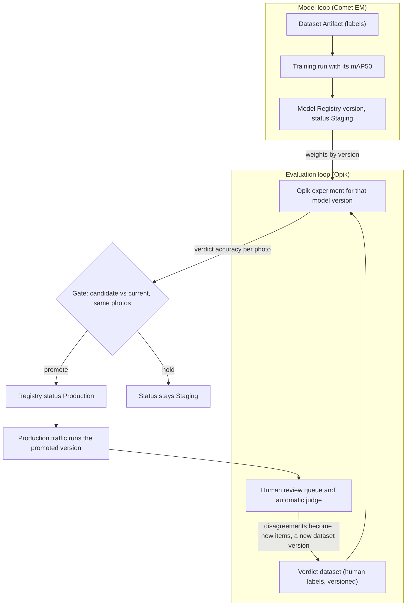
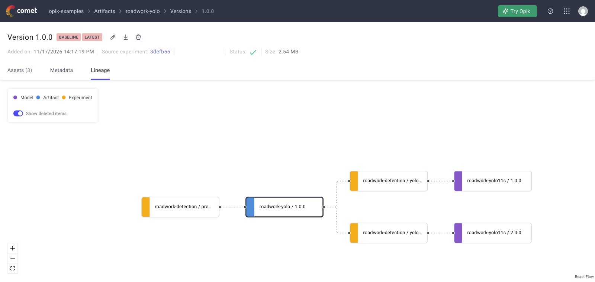
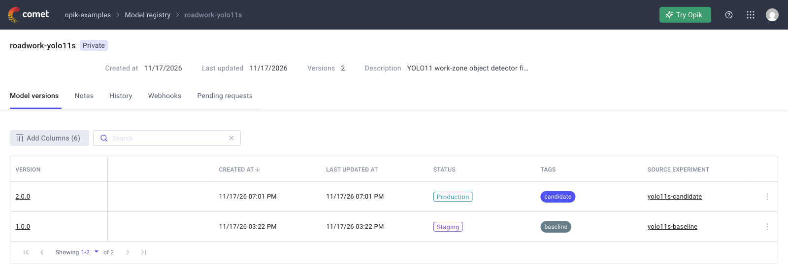
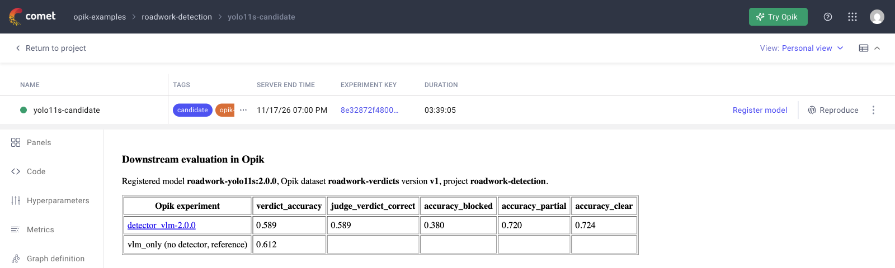
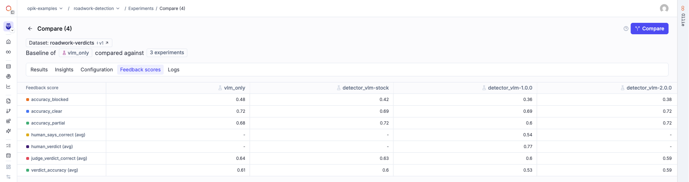
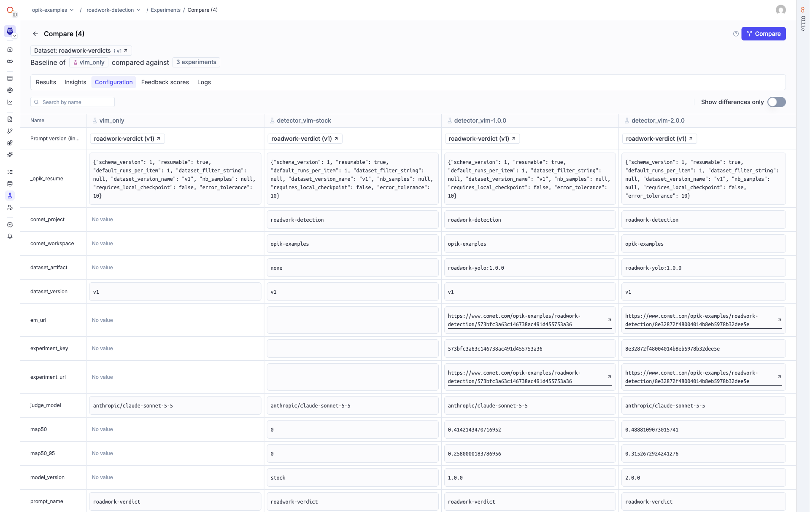

# From Comet Experiment Management to Opik: the Model Registry as the handoff

You fine-tune a model and its training metric goes up. Did the application that uses the model
get better as well? This guide builds a workflow that answers that question for every training
run, and it documents a real run in which the answer was not what the training metric suggested.

The workflow uses two Comet products. Comet Experiment Management (called "Comet EM" on this
page) tracks the model training. Opik evaluates and monitors the application that is built on
top of the model. The only thing the two sides exchange is the name and version of a model in
the Comet Model Registry.


*This is the Comet project view that the guide builds. For every registered training run it
shows the training metric, the result of the application evaluation in Opik, the decision to
promote or hold the model, and a link to the Opik evaluation.*

## What this does

A team that fine-tunes a model ends every training run with a training metric. The question the
team actually has to answer is a different one: did the application that uses the model get
better, and should this training run replace the model that is in production today? Answering
that by hand means copying a path to a weights file into an evaluation script, remembering which
dataset and which prompt the previous evaluation used, pasting numbers into a spreadsheet and
telling someone to switch the model. This guide wires that path once. After that, every training
run ends with its application result next to its training metric, and with a recorded decision to
promote or hold the model that production traffic follows automatically.

### The story of one run

The application in this guide looks at a photo from a vehicle camera and decides whether the road
ahead is blocked by roadwork. It has two parts: an object detector that the team trains, and a
vision-language model (a large language model that can also read images) that makes the final
decision.

Here is what happened when we ran the workflow, with the numbers exactly as measured:

1. We fine-tuned the detector and registered it as version 1.0.0. Its training metric looked
   reasonable for a first run.
2. We evaluated the application three times on the same 129 photos: without any detector, with
   an off-the-shelf detector, and with our fine-tuned version 1.0.0. The application was right
   on 61.2 percent of the photos without a detector, and on only 52.7 percent with our
   fine-tuned detector. The model we had just trained made the application worse.
3. We trained a second time, for longer and at a higher image resolution, and registered the
   result as version 2.0.0. The training metric improved clearly, from 0.414 to 0.489.
4. We evaluated the application with version 2.0.0. It was right on 58.9 percent of the photos.
   That is better than version 1.0.0, and it is still not better than using no detector at all.
5. A gate script compared the two versions photo by photo, decided that 2.0.0 should replace
   1.0.0, and changed the status of both versions in the Model Registry. The next batch of
   production traffic used version 2.0.0 without anyone editing a configuration file.

Judged by the training metric alone, both training runs were a success. Nobody would have seen
the real picture in a training dashboard, because the application result does not normally
appear there. The workflow in this guide puts it there. With only 129 photos, the differences
above are close to what chance alone can produce, so read them as a reason to look closer and
not as a final verdict on the detector (see [Known limits](#known-limits)).

The same pattern applies whenever an application depends on a model that you train yourself,
for example a classifier, an embedding model or a fine-tuned language model.

### The use case in detail

A vehicle camera flags a possible obstruction on the road. The application has to answer with
one of three verdicts: `blocked` (the road ahead is fully closed), `partial` (a lane is closed
or narrowed, and traffic can still pass) or `clear` (roadwork is visible and does not affect the
vehicle's path).

The guide compares two variants of the application:

- `vlm_only`: the vision-language model looks at the photo and gives the verdict on its own.
- `detector_vlm`: an object detector first marks the roadwork objects it finds in the photo, such
  as cones, barriers and signs. The vision-language model then receives the photo, a copy of the
  photo with the detected objects outlined, and the list of detections, and gives the verdict.

The detector is the part that the team trains. The verdict is what the product ships. The guide
measures both and keeps them side by side.

### Terms used on this page

| Term | What it means here |
|---|---|
| Comet EM | Comet Experiment Management, the Comet product that records model training: metrics, settings, datasets and model versions. |
| Opik | The Comet product for applications built on large language models. It records what the application did (tracing), runs evaluations and monitors production traffic. |
| Training run | One run of the training script. Comet EM calls this an "experiment". This page says "training run" to avoid confusion with Opik experiments. |
| Opik experiment | One evaluation of the application over every item of an Opik dataset, with a score for each item. |
| Artifact | A versioned set of files stored in Comet EM, here the training labels. Comet records which run produced an Artifact and which runs used it. That record is called lineage. |
| Model Registry | The place in Comet EM where trained models are stored under a name and a version number, each with a status such as `Production` or `Staging`. |
| Detector | A model that finds objects in an image and draws a box around each one. This guide uses YOLO11 ("You Only Look Once", a widely used family of detectors) from the Ultralytics library. |
| Stock detector | The YOLO11 detector as you download it, before any fine-tuning. It was trained on COCO ("Common Objects in Context"), a public dataset of everyday objects, so it knows cars and people and has never seen a traffic drum. |
| mAP50 | Mean average precision at 50 percent overlap, the usual training metric for detectors. It ranges from 0 to 1, and higher is better. A predicted box counts as correct when it overlaps a labeled box by at least half. mAP50-95 is a stricter version of the same metric. |
| Verdict accuracy | The share of photos for which the application's verdict matches the human label. This is the application metric, also called the downstream metric, because it is measured after the detector, on the finished product. |
| Trace and span | A trace is the record of one request through the application. A span is one step inside a trace, for example the detector call or the call to the vision-language model. |
| Judge | A second language model that grades the application's answer. This is often called "LLM as a judge", where LLM stands for large language model. |
| Gate | A script that compares two Opik experiments and decides whether the newer model should replace the current one. |

### Which question is answered where

| Question the team asks | Where the answer is | Which script puts it there |
|---|---|---|
| Which data was this model trained on? | In the Artifact lineage in Comet EM. One run produced the dataset, and every training run is recorded as a user of it. | `01_prepare_data.py` and `02_train.py` |
| Which model is deployed right now? | In the Model Registry. The deployed version has the status `Production`. | `03_register.py` and the gate |
| Is the application better with this model? | In Opik. There is one Opik experiment for each model version, and all of them use the same version of the same dataset. | `05_run_experiments.py` |
| Can I see that where I look at my training runs? | In Comet EM. The Opik results are written onto the training run, and a project view shows them in two custom panels. | `05_run_experiments.py` and `10_em_dashboard.py` |
| Should the model be promoted, and who decided? | In the output of the gate, in a note on both training runs, and in the status in the Model Registry. | `python -m roadwork_demo.gate` |
| What runs in production, and is it still good? | In Opik. Every production trace is tagged with the model version, an automatic judge scores new traces, and a sample goes to a human reviewer. | Scripts `06` to `09` |

### The three ideas behind the workflow

1. **The Model Registry is the contract between the two sides.** The Opik side is given a
   registry version, or simply the word `production`. It looks up everything else through the
   Comet API: the training run behind that version, the dataset that run was trained on, and its
   mAP50. There is no separate handoff file that someone has to keep up to date.
2. **The model version is a dimension of the Opik experiments.** The same dataset of photos is
   evaluated with the stock detector, with registry version 1.0.0 and with registry version
   2.0.0. The results are written back onto each training run, so Comet EM shows the training
   metric next to the application metric.
3. **A gate promotes or holds.** It compares two Opik experiments item by item. When the newer
   model wins by a clear margin, the gate changes the status in the Model Registry. New traffic
   follows the status, so nobody has to edit a configuration file.

### Two loops that meet at the gate



The left loop improves the model: new labels or new training settings lead to a new training run
and a new version in the Model Registry. The right loop improves the evaluation: a human reviews
a sample of traces, and the cases where the human disagrees with the application become new
items in the Opik dataset. A human reviewer produces verdicts, not boxes around objects, so the
reviews improve the evaluation dataset and do not become training labels for the detector.

The two loops meet at the gate, which needs both a registered model and an Opik experiment on
the current dataset. This guide runs the left loop twice and the gate once. Turning reviewed
disagreements into a new dataset version is described here and is not scripted.

### One set of names in both products

Every result can be followed from one product to the other, because the same identifiers appear
on both sides.

| Identifier | Where you find it in Comet EM | Where you find it in Opik |
|---|---|---|
| Registry model and version | On the Model Registry page, with the status and the training run it came from. | As the trace tag `detector:<model>:<version>`, in the metadata of the detector span, in the experiment configuration and in the experiment name `detector_vlm-<version>`. |
| Key and URL of the training run | On the training run itself. | In the metadata of traces and spans (`experiment_key`, `em_url`) and in the experiment configuration. |
| Version of the dataset Artifact | In the Artifact lineage. The run named `prepare-data` produced it and every training run used it. | In the experiment configuration (`dataset_artifact`). |
| Opik experiment, dataset version and scores | On the training run, in the "Other" and "Metrics" tabs (`opik_experiment_url`, `opik_dataset_version`, `opik_verdict_accuracy`, `opik_accuracy_<class>`) and in the HTML tab as a table with a link. | On the Opik experiment itself. |
| Decision of the gate | In the status in the Model Registry and in the note `opik_gate` on both training runs. | In the tags of new traffic, which name the version that is in `Production`. |

The application loads the detector from the Model Registry and not from the local training
folder, so what Opik evaluates is exactly what the registry serves. The `vlm_only` variant uses
no detector. It is evaluated once, and its traces carry no model version.

## Prerequisites

```bash
uv sync --extra detector
```

[`uv`](https://docs.astral.sh/uv/) is a Python package and project manager. Running `uv sync`
without the extra installs everything except the detector libraries (Ultralytics and PyTorch),
which is enough for the tests and the dry run. If you do not use `uv`, run
`pip install -e ".[detector]"` in this folder.

You also need the following:

- A Comet account in which Comet EM and Opik share one workspace.
- An API key for the provider of the vision-language model and the judge model.
- About 25 GB of free disk space for the dataset.
- A graphics processor for training. The default is the one in Apple Silicon Macs
  (`--device mps`). Pass `--device 0` for an NVIDIA card or `--device cpu` to train without one.

| Environment variable | Required | Description |
|---|---|---|
| `COMET_API_KEY` | For every step except step 4 | The key for Comet EM, Artifacts and the Model Registry. The Opik scripts need it as well, because they look up the detector in the registry. When it is not set, steps 1 to 3 print a line that starts with `[DRY RUN]` and stop. |
| `OPIK_API_KEY` | For steps 4 to 7 and 9 to 11 | The key for Opik. When it is not set, those scripts print a line that starts with `[DRY RUN]` and stop. |
| `COMET_WORKSPACE`, `OPIK_WORKSPACE` | Yes | The name of your workspace. Use the same workspace for both products. |
| `ANTHROPIC_API_KEY`, or the key for your model provider | For steps 5, 6, 9 and 11 | The key for the vision-language model and the judge model. The models are called through litellm, a library that gives many model providers one common interface. |
| `OPIK_PROJECT_NAME` | No | One name that is used for the Comet EM project and the Opik project. The default is `roadwork-detection`. |
| `OPIK_EXAMPLES_MODEL` | No | The vision-language model that gives the verdict, written the way litellm expects it. The default is `anthropic/claude-haiku-5-5`. |
| `JUDGE_MODEL` | No | The judge model used in Opik experiments. The default is `anthropic/claude-sonnet-5-5`. |
| `OPIK_ONLINE_JUDGE_MODEL` | No | The judge model that scores production traces. It runs inside Opik. The default is `opik-free-model`, which needs no provider key. |
| `DETECTOR_VERSION` | No | The detector that the Opik side uses: `production` (the default), a registry version such as `1.0.0`, or `stock`. |
| `REGISTRY_MODEL`, `DATASET_ARTIFACT`, `OPIK_DATASET` | No | The names of the registry model, the dataset Artifact and the Opik dataset. The defaults are `roadwork-yolo11s`, `roadwork-yolo` and `roadwork-verdicts`. |
| `PROMPT_NAME`, `QUEUE_NAME` | No | The names of the verdict prompt in the Opik Prompt Library and of the review queue. The defaults are `roadwork-verdict` and `roadwork-review`. |
| `DATA_DIR` | No | The folder that holds the dataset. The default is `./data`. |
| `OPIK_URL_OVERRIDE` | No | The base URL of a self-hosted Opik installation. The default is Opik Cloud. |

The scripts read credentials from the environment only. Copy `.env.example` to `.env`, fill it
in, and pass it to every command with `uv run --env-file .env ...`. The step numbers in the table
above refer to the table under [Running it](#running-it).

The photos and labels come from the ROADWork dataset of Carnegie Mellon University (see
[Attribution](#attribution)). You need two files, about 10 GB in total:

```bash
mkdir -p data/raw/roadwork && (cd data/raw/roadwork && curl -L -C - -o images.zip https://ndownloader.figshare.com/files/47217577 && curl -L -o annotations.zip https://ndownloader.figshare.com/files/47217703 && unzip -q annotations.zip)
```

## Running it

Start with the dry run. It needs no credentials, no dataset and no graphics processor. It runs
the unit tests, and then it runs the image helpers and the arithmetic of the gate on made-up
inputs.

```bash
bash run.sh
```

The full run follows. Run every script as `uv run --env-file .env python <script>`, in this
order.

| Step | Command | What it does | Time |
|---|---|---|---|
| 1 | `scripts/01_prepare_data.py` | Converts the labels into the format the detector expects, sets 129 photos aside for evaluation, and stores the labels in Comet EM as a dataset Artifact. | 5 minutes |
| 2 | `scripts/02_train.py --name baseline --epochs 15 --imgsz 640` | Fine-tunes the detector for 15 passes over the training data at an image size of 640 pixels. Comet EM tracks the run and records that it used the Artifact. | About 1 hour on an Apple M4 Max |
| 3 | `scripts/03_register.py --name baseline` | Registers the trained detector as version 1.0.0. The first version of a model gets the status `Production`. | 1 minute |
| 4 | `scripts/04_build_opik_dataset.py` | Creates the Opik dataset from the 129 photos and their human labels. | 2 minutes |
| 5 | `scripts/05_run_experiments.py --variants vlm_only`, then `--detector stock --variants detector_vlm`, then `--detector 1.0.0 --variants detector_vlm` | Runs three Opik experiments on the same dataset version: no detector, the stock detector and version 1.0.0. The results of the last one are written onto the training run. | 2 to 4 minutes each |
| 6 | `scripts/08_online_rule.py`, then `scripts/09_simulate_traffic.py` | Creates a rule in Opik that lets a judge model score every new production trace, and sends 30 photos through the application as simulated production traffic. The rule does not score traces that come from experiments. | 3 minutes |
| 7 | `scripts/06_review_queue.py`, then annotate in the Opik user interface, then `scripts/07_agreement.py` | Puts 10 percent of the traces into a queue for a human reviewer. After you have reviewed them, the last script reports how often the human, the application and the judges agree. Run this step after step 6, otherwise no reviewed trace has a score from the rule. | 1 minute plus the review |
| 8 | `scripts/02_train.py --name candidate --epochs 30 --imgsz 960`, then `scripts/03_register.py --name candidate` | Trains a second time, for longer and at a larger image size, and registers the result as version 2.0.0 with the status `Staging`. | About 3 hours 40 minutes on an Apple M4 Max |
| 9 | `scripts/05_run_experiments.py --detector 2.0.0 --variants detector_vlm` | Runs the Opik experiment for version 2.0.0 and writes the results onto its training run. | 3 minutes |
| 10 | `python -m roadwork_demo.gate --candidate 2.0.0`, then the same command with `--apply` | The first command prints the comparison and changes nothing. With `--apply`, the gate writes its decision to the Model Registry and to both training runs. | 1 minute |
| 11 | `scripts/09_simulate_traffic.py` | Sends another 30 photos through the application. This traffic uses whichever version now has the status `Production`. | 3 minutes |
| 12 | `scripts/10_em_dashboard.py` | Creates the Comet project view "Training vs downstream" that is shown at the top of this page. You can run it at any time after step 5. | 1 minute |

Each training run overwrites the file `runs/last_experiment.json`. If you want to register an
older run, keep a copy of that file and pass it to the script:
`scripts/03_register.py --name baseline --from runs/baseline.json`.

**Trying it quickly.** You can go through the whole workflow in a few minutes with a small
sample: `scripts/02_train.py --epochs 1 --fraction 0.05 --name smoke`,
`scripts/04_build_opik_dataset.py --limit 20` and `scripts/05_run_experiments.py --nb-samples 10`.
Opik experiments that run on a sample get the suffix `-dev` in their name, so the gate and the
project view never mix them up with full runs. `scripts/reset_dev.py` removes them. If you want
to rehearse without touching your real assets, set `OPIK_PROJECT_NAME`, `REGISTRY_MODEL`,
`DATASET_ARTIFACT` and `OPIK_DATASET` to other names.

**Running a step again.** Every step is safe to repeat. Registration is skipped when the
training run is already registered. The dataset Artifact is reused when the labels have not
changed. The Opik dataset is brought in line with the list of evaluation photos. The review queue
is only filled up to its target size for the detector version you run it for, so the traces of
a newly promoted version get a sample of their own. If you run a full Opik experiment a second
time, Opik keeps both, and the gate and the results written onto the training run use the newer
one. If that newer run stopped early, the gate refuses to use it (see
[How it works](#how-it-works)).

## What you will see

The numbers in this section come from one run on 2026-11-17, in the workspace `opik-examples`
and the project `roadwork-detection`. They are shown as measured. Nothing was tuned to make one
variant win.

### The training runs in Comet EM

| Registry version | Training run | Settings | mAP50 | mAP50-95 |
|---|---|---|---|---|
| 1.0.0 | `yolo11s-baseline` | 15 passes over the data, 640 pixels | 0.414 | 0.258 |
| 2.0.0 | `yolo11s-candidate` | 30 passes over the data, 960 pixels | 0.489 | 0.315 |

### The Opik experiments

All four experiments use version v1 of the dataset `roadwork-verdicts`, which has 129 photos:
50 labeled `blocked`, 50 labeled `partial` and 29 labeled `clear`.

| Opik experiment | Detector | Verdict accuracy | Judge agrees with the verdict | Accuracy on `blocked` | Accuracy on `partial` | Accuracy on `clear` |
|---|---|---|---|---|---|---|
| `vlm_only` | None | 0.612 | 0.636 | 0.48 | 0.68 | 0.72 |
| `detector_vlm-stock` | Stock detector, not fine-tuned | 0.597 | 0.628 | 0.42 | 0.72 | 0.69 |
| `detector_vlm-1.0.0` | Registry version 1.0.0 | 0.527 | 0.597 | 0.36 | 0.60 | 0.69 |
| `detector_vlm-2.0.0` | Registry version 2.0.0 | 0.589 | 0.589 | 0.38 | 0.72 | 0.72 |

Here is how to read the two tables together. The training metric says that both training runs
worked and that the second one worked better, with an mAP50 of 0.489 against 0.414. The
application metric tells a different story. When the vision-language model was given the output
of detector 1.0.0, its verdict accuracy fell by 8.5 percentage points compared with the same
model working alone. Most of that loss came from the photos labeled `blocked`, where accuracy
fell from 0.48 to 0.36. Detector 2.0.0 won back 6.2 of those percentage points. Even so, it is
no better than the stock detector or than no detector at all.

With 129 photos, each of these differences is close to what chance alone can produce (see
[Known limits](#known-limits)). They are a reason to look closer and not a final verdict on the
detector. The point of the guide is that you can ask the question at all, because the training
run and its application result sit next to each other in both products.

### The human review

One reviewer annotated 16 traces from the review queue.

| Comparison | Result |
|---|---|
| The human verdict against the application verdict, across the three verdicts | They agree on 56.2 percent of the traces. Cohen's kappa is 0.35. Kappa measures agreement beyond what chance would produce, where 0 means chance level and 1 means perfect agreement. |
| The judge used in Opik experiments against the human, on the question "is the application verdict correct?" | They agree on 76.9 percent of 13 traces. |
| The judge that scores production traces against the human, on the same question | They agree on 33.3 percent of 3 traces. |

The automatic rule scores production traffic only, so only the 3 production traces in the queue
carry its score. Three traces prove nothing in either direction. Review more production traces
before you rely on that score.

### The gate

This is the output of `python -m roadwork_demo.gate --candidate 2.0.0`:

```text
candidate roadwork-yolo11s:2.0.0  accuracy 0.589
current   roadwork-yolo11s:1.0.0  accuracy 0.527
items compared: 129 (dropped, not scored in both: 0)
delta: +0.062 (min delta 0.03)
items won / lost by the candidate: 18 / 10, two-sided sign test p = 0.185 (context, not a threshold)
decision: promote
dry run: nothing written
```

The same command with `--apply` prints the same comparison, and then it prints what it changed:

```text
2.0.0: status is now Production
1.0.0: status is now Staging
2.0.0: opik_gate = 'promote vs 1.0.0, delta=+0.062' on https://www.comet.com/opik-examples/roadwork-detection/8e32872f48004014b8eb5978b32dee5e
1.0.0: opik_gate = 'candidate 2.0.0: promote, delta=+0.062' on https://www.comet.com/opik-examples/roadwork-detection/573bfc3a63c146738ac491d455753a36
```

The gate promotes a candidate when its verdict accuracy is higher than that of the current
version by at least 3 percentage points. Version 2.0.0 was 6.2 percentage points higher, so the
gate promoted it. The 30 photos of simulated traffic that ran before the gate are tagged
`detector:roadwork-yolo11s:1.0.0`. The 30 photos that ran after the gate are tagged
`detector:roadwork-yolo11s:2.0.0`, and nobody changed any configuration in between.

Read the line about the sign test before you trust the decision. The candidate was right on 18
photos where the current version was wrong, and wrong on 10 photos where the current version was
right. The sign test asks how often a split at least this uneven would appear if the two
versions were in fact equally good, and the answer is about 18 percent of the time (p = 0.185).
The gate decides on the size of the difference and not on this test. On an evaluation set this
small, "promote" therefore means "better on this sample". The right fix is a larger evaluation
set, not a lower threshold.

### What it looks like in Comet EM

The image at the top of this page is the project view that `scripts/10_em_dashboard.py`
creates. A project view is a saved page layout in Comet EM, and a panel is one chart or widget
on it. The view has three panels:

- The table at the top is a custom panel written in Python. It has one row for each registered
  training run, with the mAP50, the verdict accuracy from Opik, the difference to running no
  detector, the decision of the gate and a link to the Opik experiment.
- The chart at the bottom left is a built-in Comet chart. It shows how the mAP50 of both
  training runs developed during training.
- The chart at the bottom right is a custom panel written in JavaScript. It shows the verdict
  accuracy for each of the three verdicts and for each detector version, next to the result
  without a detector.

The chart on the left tells you that version 2.0.0 is the better detector. The chart on the
right tells you that the application is still not better than it is without a detector. Seeing
both on one page is the purpose of this guide.


This is the "Experiments" tab of the same view. The registry version, the mAP50, the verdict
accuracy from Opik, the note from the gate and the dataset Artifact are ordinary columns of the
table. You can sort and filter training runs by their application result in the same way as by
any training metric.



This is the lineage of the dataset Artifact `roadwork-yolo:1.0.0`. The run named `prepare-data`
on the left produced the Artifact. Both training runs used it, and each training run leads to
its version in the Model Registry on the right. The question "which data was this model trained
on?" is answered one click away from the model.



This is the Model Registry after the gate ran with `--apply`. Version 2.0.0 has the status
`Production`, version 1.0.0 is back to `Staging`, and each version links to the training run it
came from. When the Opik side is told to use `production`, this status is what it reads.



This is the HTML tab of the second training run. `05_run_experiments.py` wrote this table. It
names the registry version and the version of the Opik dataset, lists the scores and links to
the Opik experiment.

### What it looks like in Opik



This is the comparison of the four Opik experiments, on the tab "Feedback scores". A feedback
score is the name Opik uses for any score attached to a trace or an experiment. All four
experiments use the same version of the dataset, so their columns can be compared directly: no
detector, the stock detector, registry version 1.0.0 and registry version 2.0.0. The row
`accuracy_blocked` shows where a detector costs the most. Accuracy on those photos is 0.48
without a detector and between 0.36 and 0.42 with one. The two rows that start with `human_`
come from the review queue, and only the experiment `detector_vlm-1.0.0` has reviewed traces.



This is the tab "Configuration" of the same comparison. Every experiment that used a detector
names the registry version it ran with, the key and the URL of the training run, the mAP50 of
that run and the dataset Artifact. Someone who looks at a result in Opik can get back to the
exact training run without asking anyone.


This is one trace from the traffic that was simulated after the gate. The span named `detector`
is selected. It carries the photo with the detected objects outlined, the tag
`detector:roadwork-yolo11s:2.0.0` and, as metadata, the registry version, the training run and
its mAP50. The span named `verdict` below it holds the call to the vision-language model, with
the number of tokens and the cost. If you filter the logs by the tag `source:simulated-traffic`,
you see the traffic of whichever version is in `Production`, with the scores of the automatic
rule.

## How it works

1. **Data and lineage** (`scripts/01_prepare_data.py`, `scripts/02_train.py`). The data
   preparation script stores the training labels as a Comet Artifact from a short run of its
   own. The training script asks Comet for that Artifact by calling
   `experiment.get_artifact(...)`. Because of these two calls, Comet records one producer of the
   dataset and every training run as a user of it. The photos themselves are not uploaded. The
   Artifact holds a pointer to where they came from.
2. **Registration with a status** (`scripts/03_register.py`). The first version of a model is
   registered with the status `Production`, because it is by definition what is deployed today.
   Every later version is registered with the status `Staging`, and it has to earn `Production`
   through the gate. If the script cannot read the registry, it stops with the error. It never
   treats a failed lookup as "this is the first version".
3. **The handoff through the registry** (`src/roadwork_demo/registry.py`, function
   `resolve_handoff`). This function is given `production`, a version number or `stock`. It asks
   the Model Registry for that version, reads from the version which training run produced it,
   and reads the dataset Artifact and the mAP50 from that training run. If you ask for
   `production` and no version has that status, the function stops with an error that tells you
   how to fix it. It never falls back to the newest version, because the newest version could be
   a candidate that the gate decided to hold.
4. **The traced application** (`src/roadwork_demo/pipeline.py`). The function `run_frame`
   handles one photo, and Opik records it as one trace. The trace has a span for the detector,
   with the outlined photo attached, and a span for the call to the vision-language model, with
   the number of tokens and the cost. Traces that used a detector carry the registry model and
   version as tags and as metadata.
5. **One Opik experiment for each model version** (`scripts/05_run_experiments.py`). The Opik
   function `evaluate()` runs the application over every photo in the dataset. Two metrics score
   each answer. The first checks whether the verdict is exactly the human label. The second is a
   judge model that sees the photo and the answer, and does not see the human label. The script
   also logs the accuracy for each of the three verdicts as a score of the whole experiment. It
   records the version of the Opik dataset in the experiment configuration and on the training
   run. The accuracy without a detector is written onto the training run only when the
   `vlm_only` experiment used the same dataset version, the same vision-language model and the
   same prompt. Otherwise the field says `not comparable`.
6. **The gate** (`src/roadwork_demo/gate.py`). The gate refuses to compare two experiments that
   used different versions of the dataset, a different vision-language model or a different
   prompt, because the comparison would not be fair. It pairs the two experiments on the photos
   that both of them scored, and it refuses to decide when fewer than 9 in 10 photos were scored
   by both, which is what an experiment that stopped early looks like. It reports the difference
   in accuracy, the number of photos the candidate won and lost, and a sign test. It promotes
   the candidate when the gain is at least the value of `--min-delta`, which is 0.03 by default.
   With `--apply`, it first sets the candidate to `Production` and then sets the previous
   version to `Staging`. If the first change fails or is waiting for approval, nothing else is
   changed. With `--apply`, the gate
   also refuses to promote when the version it compared against is not the one that is in
   `Production`. This way the registry never ends up with a deployed version that the candidate
   was not compared with. If the registry does not take a status change, the note on the
   training runs says `promote (not applied)` and the command ends with an error, so a decision
   that did not reach the registry cannot be mistaken for one that did.
7. **Human review and automatic scoring** (scripts `06` to `09`). A sample of traces goes to an
   annotation queue, which is a list in the Opik user interface where a person reviews traces
   one by one. `07_agreement.py` reports how often the human and the application agree, and how
   often each judge agrees with the human. The automatic rule scores new production traces
   inside Opik. Check any automatic judge against human labels before you trust its numbers.
   Step 7 gives you that check for every judge.
8. **The project view** (`scripts/10_em_dashboard.py` and the folder `panels/`). The module
   `comet_ml.views` describes a project view in code, and `API.create_view` saves it to Comet.
   `panels/scorecard.py` is the Python panel. Comet runs it on its own servers, where it reads
   the training runs that are shown on the page with `API().get_panel_experiments()` and renders
   one table row for each registered run. `panels/per_class_accuracy.js` is the JavaScript
   panel. It runs in your browser and draws the verdict accuracy for each detector version.
   Both panels only read what steps 3, 5 and 10 wrote onto the training runs, so they need no
   access to Opik. They do not show the status in the Model Registry, because a panel is not
   allowed to read the registry.

The folders in this guide:

```
src/roadwork_demo/   configuration, registry lookup, the application, model calls, metrics, the gate, data helpers
scripts/             the dry run (00), then the numbered steps in the order you run them
panels/              the source code of the Python panel and the JavaScript panel
prompts/             the prompts for the verdict and for the judge (Opik stores the versions of the verdict prompt)
tests/               unit tests for the logic that needs no network
```

## Known limits

- **The evaluation set is small.** It has 129 photos, so a single photo is worth 0.78
  percentage points. For an accuracy near 0.55, the 95 percent confidence interval is about
  plus or minus 8.6 percentage points. A difference of less than about 8 percentage points
  between two experiments can be the result of chance. The gate prints the photos won and lost
  and the sign test to make this visible.
- **The application sees single photos only.** Deciding whether an obstruction lasts for minutes
  or for hours would need video or repeated observations.
- **The detector knows roadwork objects only.** These are cones, drums, barriers, barricades,
  roadwork signs and similar objects. It does not know general traffic signs.
- **The human labels are derived, and some noise remains.** The verdicts come from the tag
  `travel_alteration` that human annotators gave each ROADWork scene. The tag value
  `Fully Blocked` becomes `blocked`, exactly `Partially Blocked` becomes `partial`, and exactly
  `None` becomes `clear`. The tag `Fully Blocked` also covers closed sidewalks and closed side
  streets. A photo therefore counts as `blocked` only if its human-written scene description
  says that the road itself is closed (see `describes_own_road_closed` in
  `src/roadwork_demo/data.py`).
- **The evaluation photos were used to pick the best training checkpoint.** They come from the
  validation part of the detector's dataset. The detector was never trained on them, and the
  training process did use them to choose which saved state of the model to keep.
- **The `clear` class is small.** It has 29 photos, so its accuracy moves in large steps.
- **An automatic judge is only as good as its agreement with humans.** Measure that agreement
  in step 7 before you read the judge's scores. A free default model can be far off.
- **The gate note on a training run is the latest one only.** Every run of the gate with
  `--apply` overwrites the field `opik_gate` on both training runs it compared. When a third
  version is later compared with version 2.0.0, the note that says why 2.0.0 was promoted is
  replaced by the note about the new candidate. The status history in the Model Registry keeps
  the full record.
- **Links to Comet in Opik trace metadata may not be clickable.** The field `em_url` can show as
  plain text. Use the links on the Comet side, in the HTML tab, or copy the key of the training
  run.

## What to take away

- A better training metric does not guarantee a better application. In this run the detector
  improved from 0.414 to 0.489 in mAP50, and the application was still not better than it was
  without a detector.
- You only see this when the application result is shown where the training runs are. Writing
  the Opik results onto the training run takes a few lines of code, and a project view makes
  them the first thing the team sees.
- When the Model Registry is the only thing the two sides share, there is no handoff file to
  keep up to date, and every result can be followed back to the training run and the data
  behind it.
- A gate turns the comparison into a recorded decision. Be honest about its limits: on a small
  evaluation set, a promotion means "better on this sample".

## Related guides

- [tracing_finetuned_models](../tracing_finetuned_models/) is the starting point. It registers a
  fine-tuned model and puts the link to its registry entry on Opik traces. This guide is the
  full workflow that follows from it.
- [eval_in_ci](../eval_in_ci/) shows a complete evaluation gate that runs in continuous
  integration, on every pull request.

## Attribution

The photos and annotations come from the **ROADWork dataset** of Carnegie Mellon University:
https://github.com/anuragxel/roadwork-dataset , with the data hosted at
https://kilthub.cmu.edu/articles/dataset/ROADWork_Data/26093197 . The dataset is released under
the Open Data Commons Attribution License version 1.0. If you use it, cite:

> Ghosh, Zheng, Tamburo, Vuong, Alvarez-Padilla, Zhu, Cardei, Dunn, Mertz, Narasimhan.
> "ROADWork: A Dataset and Benchmark for Learning to Recognize, Observe, Analyze and Drive
> Through Work Zones." ICCV 2025.

This repository does not redistribute the dataset. Its scripts download and convert it. The
only ROADWork photos in the repository are the camera frames that are visible in the screenshots
above. The guide uses the files `images.zip` and `annotations.zip` only. It does not use
`discovered_images.zip`, which holds third-party images under other licenses.
