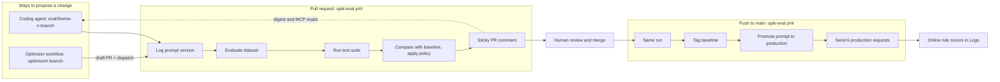
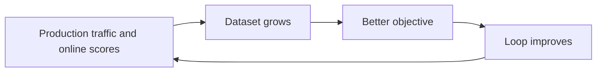

# Run Opik evaluations in CI and close the loop with a coding agent

## What this does

This guide is a small, working reference for one evaluation gate in GitHub Actions. On every pull
request it runs an Opik evaluation of your app, runs a test suite, compares the result item by item
with a tagged baseline, applies a policy file, and posts one sticky comment that names the prompt
version under test. On a push to `main` the same run becomes the new baseline, the prompt version
gets the `production` environment, and a few simulated production requests are scored by an online
rule. Two things feed changes into that gate: a coding agent (Cursor or Claude Code) following a
runbook, and a manual optimizer workflow that opens a draft PR with a better prompt. Neither one
promotes anything; the gate and a human merge decide.

The app under test is a small LLM planner (`planner.py`) that turns a driving scenario into a JSON
plan, scored on 20 scenarios. Swap in your own app, dataset and metric; the gate does not change.

### What you get

A sticky comment on each pull request. This sample is the digest of a real main-run (the push to
`main` that tags the baseline, promotes the prompt to `production` and sends simulated traffic),
from the verification run against Opik Cloud. It compares the new prompt with the previous main
baseline. The offline demo (`uv run python run_eval.py demo`) prints the same layout without
calling a model: it scores sample outputs of a weak prompt (the baseline) against
`prompts/system.txt` (the candidate).

```markdown
<!-- opik-eval -->
## Opik eval: main-87ef097

Baseline: main-b73dfb3 (01a1cc97-5a3d-7d3f-8f06-910bc2368488)
Prompt: scenario-planner v3

**Verdict:** baseline_created

Pass rate: 0.50 -> 0.55 (+0.05)
Items scored: 20 | Pass rule: 1 trial
Policy: defaults
Test suite: 8 of 8 passed
Promoted to production: scenario-planner v3
Sent 6 production requests; online rule scores them in Logs: https://www.comet.com/opik/opik-examples/projects/01a1cc97-4277-7261-9f0b-8c668a72e308/logs

### Newly failing

none

### Newly passing

- s06: passed ([trace](https://www.comet.com/opik/opik-examples/projects/01a1cc97-4277-7261-9f0b-8c668a72e308/traces?trace=01a1cc9b-f52b-7676-95f8-bfa7267fe7cc))

### Still failing

- **maneuver_correct**
  - s20 ([trace](https://www.comet.com/opik/opik-examples/projects/01a1cc97-4277-7261-9f0b-8c668a72e308/traces?trace=01a1cc9b-e5cb-7ad4-b3bf-059ed1fa3483))
  - s19 ([trace](https://www.comet.com/opik/opik-examples/projects/01a1cc97-4277-7261-9f0b-8c668a72e308/traces?trace=01a1cc9b-e5ce-71dd-b952-19ac321c7400))
  - s18 ([trace](https://www.comet.com/opik/opik-examples/projects/01a1cc97-4277-7261-9f0b-8c668a72e308/traces?trace=01a1cc9b-e5d0-79b5-95f1-a97bd77d29c5))
  - s17 ([trace](https://www.comet.com/opik/opik-examples/projects/01a1cc97-4277-7261-9f0b-8c668a72e308/traces?trace=01a1cc9b-e5d2-763b-abfa-7537a1b025fc))
  - s16 ([trace](https://www.comet.com/opik/opik-examples/projects/01a1cc97-4277-7261-9f0b-8c668a72e308/traces?trace=01a1cc9b-ee3e-7d5a-b355-3213fab111c6))
  - s15 ([trace](https://www.comet.com/opik/opik-examples/projects/01a1cc97-4277-7261-9f0b-8c668a72e308/traces?trace=01a1cc9b-eec9-73cc-a2c6-923b7586abcf))
  - s14 ([trace](https://www.comet.com/opik/opik-examples/projects/01a1cc97-4277-7261-9f0b-8c668a72e308/traces?trace=01a1cc9b-eed1-7453-88c6-04b74294e030))
  - s13 ([trace](https://www.comet.com/opik/opik-examples/projects/01a1cc97-4277-7261-9f0b-8c668a72e308/traces?trace=01a1cc9b-ef1e-7f16-b425-9ffd6edf22f0))
  - s12 ([trace](https://www.comet.com/opik/opik-examples/projects/01a1cc97-4277-7261-9f0b-8c668a72e308/traces?trace=01a1cc9b-f177-7de7-8e07-9b2725b72121))

### Flaky

none

### New items

none

### Per-metric means

| metric | baseline | candidate | delta |
|---|---|---|---|
| maneuver_correct | 0.55 | 0.55 | +0.00 |
| scenario_pass | 0.50 | 0.55 | +0.05 |
| parameters_correct | 0.95 | 1.00 | +0.05 |
| actors_correct | 1.00 | 1.00 | +0.00 |

### Compare

[Open in Opik](https://www.comet.com/opik/opik-examples/experiments/01a1cc97-4261-71a5-a266-d4d9072a3883/compare?experiments=%5B%2201a1cc97-5a3d-7d3f-8f06-910bc2368488%22%2C%20%2201a1cc9b-e3fb-74a7-bfb0-fe8206043cf6%22%5D)
```

On a pull request the comment has the same layout: the header names the experiment
(`<branch>-<sha7>`), the prompt line reads `Prompt: scenario-planner <version>` (with
`(unchanged)` when it matches `production`), and the verdict is `ok` or `hold` instead of
`baseline_created`. Only `main` promotes the prompt and sends traffic. Every failing item links to
its worst trace, and "Compare" opens the experiment compare view in Opik.

### What you will see in Opik

All of it lives in one project (`eval-in-ci-example` in the workflow template).

| Opik page | What appears | When |
|---|---|---|
| Datasets | `scenario-planner`, 20 driving scenarios with the expected plan | First run (setup) |
| Prompt library | Prompt `scenario-planner`: a `prompts/system.txt` text that already has a version reuses it (the `production` one first, then the newest match in the history), a new text logs a new version with a change description `ci <sha7> <branch>` (plus `pr <n>` on PRs) | Every run |
| Experiments | `<branch>-<sha7>`, linked to that prompt version, tagged `ci`, the branch, and `candidate` on PRs or `baseline` on `main` | Every run |
| Prompt library | The `production` environment on the version `main` last evaluated | Push to `main` |
| Test suites | `scenario-planner-guardrails` (3 assertions on 8 scenarios) and a run `<branch>-<sha7>-suite` tagged `test-suite` | Every run |
| Logs | 6 traces tagged `simulated-traffic`, each with a `plan_consistent` score from the online rule `scenario-plan-consistency` | Push to `main` |



### What is in the folder

The source lives at
[`guides/eval_in_ci`](https://github.com/comet-ml/opik-examples/tree/main/guides/eval_in_ci) in
opik-examples. Copy the folder to `examples/eval_in_ci/` in your repo; the workflows and the
runbook's guard paths assume that destination.

| File | Purpose |
|---|---|
| `run_eval.py` | CLI with three modes: `run` (evaluate, test suite, compare, promote on `main`), `digest` (compare a finished experiment) and `demo` (offline) |
| `eval_compare.py` | Item compare, policy verdict, digest rendering (no network) |
| `opik_access.py` | SDK and REST layer: baseline lookup, prompt logging and environments, compare rows, URLs |
| `composite_metric.py` | `CompositePassMetric`: one pass/fail per item from several sub-metrics |
| `planner.py` | The app: the eval task, the test-suite task, the production entry point and the traffic hook |
| `scenarios.py` | The 20 scenarios, the 6 production requests, plan parsing, sub-metrics and `build_metric` |
| `setup_opik.py` | Idempotent setup: `production` environment, dataset, test suite, online rule |
| `config.py` | Names and models shared by every step |
| `optimize_prompt.py` | The optimizer step: rewrites `prompts/system.txt` |
| `ci_output.py` | Job summary, step outputs and exit code 2 on any failure |
| `prompts/system.txt` | The prompt under test; `prompts/weak.txt` is the demo baseline |
| `github/opik-eval.yml` | The gate workflow template |
| `github/opik-optimize.yml` | The manual optimizer workflow template |
| `agent/opik-eval-loop.md` | The coding-agent runbook; `agent/cursor/` and `agent/claude/` carry the same text (a test keeps them identical) |
| `run.sh` | Entry point for smoke runs: the offline demo, or a live run when credentials are set |
| `pyproject.toml` | Dependencies (`uv sync --group dev`; the optimizer is an optional extra) |
| `.env.example` | Variable names for local runs |
| `tests/` | Unit tests, no network: `uv run pytest` from this folder |

## Prerequisites

- Python 3.12 or 3.13 and [uv](https://docs.astral.sh/uv/). From this folder:

  ```bash
  uv sync --group dev
  # without uv: pip install "opik==2.2.143" "litellm>=1.70" pyyaml
  ```

- An Opik workspace on Opik Cloud or your own host: a 2.2.x server recent enough for prompt
  environments, test suites and online rules.
- The `opik` SDK pinned to a version that matches your server. `pyproject.toml` pins
  `opik==2.2.143`, the version this guide is tested with; change the pin to your server's version.
  The workflow installs whatever `pyproject.toml` says.
- An Opik API key for CI: a service-account key if your deployment has them (Admin dashboard >
  Service accounts), otherwise a dedicated personal API key.
- A model provider key for the live path (Anthropic by default). The offline demo needs nothing.
- For the online rule, an AI provider configured in the Opik workspace that matches
  `OPIK_ONLINE_JUDGE_MODEL`. The rule runs inside Opik, not in CI.

In GitHub, keys go in repository secrets and everything else in repository variables
(Settings > Secrets and variables > Actions):

| Name | Kind | Required | Notes |
|---|---|---|---|
| `OPIK_API_KEY` | secret | yes | Opik API key |
| `ANTHROPIC_API_KEY` | secret | live path | Key for the default model; or `OPENAI_API_KEY` with an `openai/...` model |
| `OPENAI_API_KEY` | secret | if you use OpenAI | Read by the gate workflow; add it to the optimizer workflow's env if you use it there |
| `OPIK_WORKSPACE` | variable | yes | The path segment after `/opik/` in the UI URL |
| `OPIK_URL_OVERRIDE` | variable | custom host only | `https://<host>/opik/api`; the workflows default to Opik Cloud (`https://www.comet.com/opik/api`) |
| `OPIK_EXAMPLES_MODEL` | variable | no | LiteLLM model name for the app and the optimizer; default `anthropic/claude-haiku-4-5-20251001` |
| `OPIK_ONLINE_JUDGE_MODEL` | variable | no | Model of the online rule; default `claude-haiku-4-5-20251001`; must match an AI provider configured in the workspace, by its bare model name (no `anthropic/` prefix) |

Two more variables matter outside GitHub: `OPIK_PROJECT_NAME` (the workflow sets
`eval-in-ci-example`; `run.sh` defaults to `eval-in-ci-smoke`; `.env.example` uses
`eval-in-ci-local`) and `OPIK_EVAL_GIT_SHA` (set by the workflow to the PR head commit, used in
experiment names). For local runs copy `.env.example` to `.env`, fill it in and export it (the
scripts do not read `.env` themselves).

## Running it

Run every command from this folder (`guides/eval_in_ci` here, `examples/eval_in_ci` after copying
it).

### Offline demo, no credentials

```bash
bash run.sh
# or: uv run python run_eval.py demo
```

No Opik server and no model calls. Without `OPIK_API_KEY` and `OPIK_WORKSPACE`, `run.sh` runs the
demo, which prints a digest in the layout shown in "What you get" (weak prompt against
`prompts/system.txt`) and exits 0. The last line explains that the
demo exit code is always 0; in CI the gate uses `run --fail-on-regression` so a hold fails the job.
`run` and `digest` deliberately exit 2 without credentials instead of falling back to the demo: in
CI that keeps a fork pull request from showing a green eval that never ran.

### Live run from your machine

```bash
cp .env.example .env   # then fill in the keys and the workspace
set -a; source .env; set +a
bash run.sh
```

With credentials, `run.sh` runs the same command as the workflow, without a gate flag: setup
(environment, dataset, test suite, online rule), the evaluation, the test suite and the digest.
Pass extra flags through, for example `bash run.sh --fail-on-regression`.

### 10-minute setup for CI

1. Add the secrets and variables from Prerequisites.
2. Copy this folder to `examples/eval_in_ci/` and `github/opik-eval.yml` to
   `.github/workflows/opik-eval.yml`. The paths in the workflow assume that folder.
3. Install your project. Uncomment the "Install your project" step in the workflow and point it at
   your repo (`uv pip install -e ../..` from `examples/eval_in_ci` installs the repo root into the
   eval environment), so `--task` can import your code.
4. Point the flags of the "Run evaluation" step at your code:
   - `--task module:callable` is a factory. It is called with the prompt text (or `None` without
     `--prompt-file`) and returns the per-item task, which takes the dataset item dict and returns
     a dict for the metric. See `make_eval_task` in `planner.py`.
   - `--metric module:callable` is a zero-argument factory that returns the metric. To gate on
     several scores at once, return a `CompositePassMetric` as `scenarios.build_metric` does.
   - `--dataset` is your Opik dataset name.
   - `--prompt-file` is the prompt file your app uses. Each run logs it as a prompt version and
     links the experiment to it.
   - Optional: `--setup module:callable` (called once with the Opik client; if it returns an object
     with a `dataset` attribute, that dataset is used), `--suite-task` with `--suite-name` (same
     factory shape as `--task`; the task must return `input` and `output`, the two fields the
     assertion judge reads), and `--traffic module:callable` (called with the client and the prompt
     name after promotion; returns the number of requests sent). Drop the ones you do not need;
     `setup_opik:run_setup` creates this guide's dataset, suite and rule, not yours.
   - `--label-key` names the dataset field the digest shows for each item (default `scenario_id`).
   - The gate counts an item as passing from one 0/1 score named by `--pass-score` (default
     `scenario_pass`), which `CompositePassMetric` emits. A plain metric that returns another name
     needs the flag, or a `CompositePassMetric` wrapped around it.
5. Merge to `main` once. That run creates the first `baseline`-tagged experiment that later pull
   requests compare against, and gives the prompt version the `production` environment.

On `pull_request`, uncomment `paths:` in the workflow to run the gate only when your app or the
eval changes. The workflow template pins actions by major version; security-reviewed repos usually
pin them to commit SHAs.

### The run and digest commands

The command the workflow runs:

```bash
uv run python run_eval.py run --dataset scenario-planner --task planner:make_eval_task \
  --metric scenarios:build_metric --prompt-file prompts/system.txt \
  --setup setup_opik:run_setup --suite-task planner:make_suite_task \
  --suite-name scenario-planner-guardrails --traffic planner:simulate_traffic_hook \
  --fail-on-regression --out digest.md --json digest.json --summary "$GITHUB_STEP_SUMMARY"
```

On a push to `main` the workflow passes `--mark-baseline` instead of `--fail-on-regression`.

`run` flags: `--dataset`, `--task`, `--metric` (all three required), `--prompt-file`, `--prompt-name`
(default `scenario-planner`), `--setup`, `--suite-task`, `--suite-name`, `--traffic`,
`--suite-model` (the model that judges the test-suite assertions, default `OPIK_EXAMPLES_MODEL`),
`--label-key`, `--trials` (default 1), `--mark-baseline`, `--pr`, `--baseline`,
`--pass-score` (default `scenario_pass`), `--pass-threshold`, `--policy`, `--fail-on-regression`, `--out`, `--json`, `--summary` (append a
failure note, for example `$GITHUB_STEP_SUMMARY`) and an optional `--project`. On `run`,
`--project` names the project the experiment is filed under and is the first place an experiment
is looked up by name; on `digest` it is only that lookup hint. Without it the SDK uses
`OPIK_PROJECT_NAME`.

Compare a finished experiment without re-running it:

```bash
uv run python run_eval.py digest --experiment <name or id>
```

`digest` flags: `--experiment`, `--project`, `--label-key`, `--baseline`, `--pass-score`,
`--pass-threshold`,
`--policy`, `--fail-on-regression`, `--out`, `--json`, `--summary`. `demo` flags:
`--pass-threshold`, `--policy`, `--out`, `--json`.

### Reading the digest

`digest.md` is Markdown whose first line is exactly `<!-- opik-eval -->`. The workflow uses that
marker to update a single sticky comment on the pull request instead of adding a new one per push.
Top to bottom: the experiment name, a `Warning:` line when `main` promoted a run with failed
criteria or created no baseline, the baseline, the prompt version (`(unchanged)` when it is the one `production` already
has), the verdict with any failed criteria, the pass rate against the baseline, items scored and
the pass rule (`1 trial` or `all N trials`), notes (the policy used, test suite, promotion, traffic), the "Newly
failing", "Newly passing", "Still failing" (grouped by metric), "Flaky" and "New items" lists, the
per-metric means and the compare link. `digest.json` carries the same data for scripts.

Verdicts: `ok`, `hold` (a regression, a lower pass rate or a failed test suite),
`insufficient_evidence` (too few scored items), `no_baseline` (no `baseline`-tagged experiment
yet) and `baseline_created` (a `main` run).

The exit code is the contract:

| Code | Meaning |
|---|---|
| 0 | `ok`, `baseline_created` or `no_baseline` (and any verdict without `--fail-on-regression`) |
| 1 | `hold` or `insufficient_evidence`, only with `--fail-on-regression` |
| 2 | Configuration or connection error, invalid policy file, or a crash in your task, metric or test suite; the error is also appended to the job summary, with what was already done before it |

The workflow captures the code, still uploads `digest.md` and `digest.json`, posts the comment, and
then fails the job with the original code in a final step that runs `if: always()`.

### Optimizer: a prompt PR on demand

`github/opik-optimize.yml` is a manual workflow (Actions > opik-optimize > Run workflow, input
`max_trials`, default 3). Copy it to `.github/workflows/opik-optimize.yml`. It:

1. starts from the prompt version that has the `production` environment, or from
   `prompts/system.txt` when there is none;
2. runs Opik's `MetaPromptOptimizer` on the `scenario-planner` dataset with the composite metric as
   the objective, so a better prompt means more items passing every threshold;
3. writes the best prompt to `prompts/system.txt`, and nothing else;
4. pushes it to an `optimize/<run number>` branch and opens a draft PR;
5. dispatches `opik-eval.yml` on that branch, because a PR opened with `GITHUB_TOKEN` fires no
   `pull_request` event, so the gate would never run on it otherwise.

The dispatched run shows up as a check on the branch with the digest in its job artifact, and the
comment step finds the branch's open PR and posts the sticky comment there (a dispatch on a branch
without an open PR posts nothing). If you want the normal `pull_request` trigger, open the PR with a
GitHub App token (`actions/create-github-app-token`) instead and drop the dispatch step.

Requirements: the repository setting "Allow GitHub Actions to create and approve pull requests"
(Settings > Actions > General), the workflow permissions `contents: write`, `pull-requests: write`
and `actions: write`, and the dataset, which the gate's setup creates on its first run. When the
optimizer's best prompt equals the starting one, or matches the file already in the repo, no PR is
opened. To run the optimizer locally:

```bash
uv sync --extra optimizer
uv run python optimize_prompt.py --max-trials 3
```

Flags: `--prompt-file` (default `prompts/system.txt`), `--prompt-name`, `--max-trials` (default 3),
`--summary`, `--github-output`, `--json`. Without credentials it prints what it would do and
exits 0.

### Close the loop with a coding agent

`agent/opik-eval-loop.md` is the runbook for one iteration: pull the digest, diagnose the failing
items (with the Opik MCP if it is connected, otherwise from the digest's trace links), pick one
theme, write the hypothesis to `EVAL_LOG.md`, push an `eval/<theme>-<n>` branch and a draft PR, read
the gate's result, accept or reject, and log it. Install it as a Cursor rule
(`agent/cursor/opik-eval-loop.mdc`, into `.cursor/rules/`) or a Claude Code skill
(`agent/claude/opik-eval-loop/`, into `.claude/skills/`). Optimizer PRs on `optimize/<n>` branches
follow the same rules.

### Debug with the Opik MCP

CI never needs the Opik MCP server. It is the quickest way for a person or a coding agent to open
the failing items and spans the digest points at: the experiment, the compare rows filtered to
failing items, the spans of the worst trace, and the one or two span bodies that explain a
failure. The runbook lists the exact calls and their sizes.

- Setup and tools: https://www.comet.com/docs/opik/mcp-server
- What to ask it: https://www.comet.com/docs/opik/mcp-server/use-cases
- Custom host or self-hosted Opik, including the Cursor `mcp.json`:
  https://www.comet.com/docs/opik/mcp-server/advanced-setup

On a custom host the MCP server reads `COMET_URL_OVERRIDE=https://<host>` (no `/opik/api`), not the
SDK's `OPIK_URL_OVERRIDE`.

### Cost

A pull request run makes 20 model calls for the evaluation (one per scenario, `--trials 1`), and
the test suite makes 16 (8 items x 2 runs) plus the judge calls for its assertions. Those judge
calls run on the same model as the app by default (`--suite-model`, default
`OPIK_EXAMPLES_MODEL`), so the default setup needs only the Anthropic key. A push to
`main` adds 6 production calls and 6 online-rule judge calls. The optimizer is the expensive one:
it scores several candidate prompts on the 20 scenarios per trial. With a small model such as
Claude Haiku a gate run costs cents; check the optimizer's spend in the optimization run before
raising `max_trials`.

### Other CI systems

`run_eval.py` only needs Python, the environment variables above and the exit code. Port the
workflow by running the same command, uploading `digest.md`, posting it as a comment, and failing
the job on a non-zero code.

### Troubleshooting

- **Dataset not found.** `OPIK_WORKSPACE` or `OPIK_API_KEY` set in your shell overrides
  `~/.opik.config`. If they point at different workspaces, the dataset is not found. Check which
  workspace each one names.
- **No experiment found.** Usually the wrong workspace (see the item above), or a name typed with
  the branch as is: experiment names replace `/` in the branch with `-`, so `eval/brake-1` at
  `abc1234` is `eval-brake-1-abc1234`. When several experiments share the exact name, the newest
  wins; pass the experiment id to read an older one.
- **Exit code 2.** A configuration, policy-file or connection problem, or a crash in your task or
  metric, not a regression. The job summary has the message. The agent runbook says to stop on it
  rather than treat it as a failed change.
- **Fork pull requests exit 2 by design.** GitHub gives fork PRs empty secrets and a read-only
  token, so the eval cannot reach Opik.
- **Online scores never appear in Logs.** The judge model in `OPIK_ONLINE_JUDGE_MODEL` does not
  match an AI provider configured in the workspace. Fix the variable, then delete the rule
  `scenario-plan-consistency` in Opik so the next run's setup recreates it (setup never edits an
  existing rule).
- **The optimize workflow opened no PR.** Either the prompt did not change (the job summary says
  `Prompt file: unchanged`), or `gh pr create` failed because the repository does not allow GitHub
  Actions to create pull requests. Turn on "Allow GitHub Actions to create and approve pull
  requests" in Settings > Actions > General.

## How it works

### The composite metric pattern

An agent run usually has several things that must all be right. `CompositePassMetric` in
`composite_metric.py` takes several sub-metrics, each with a threshold, and reports one
`scenario_pass` score per item: 1 only when every sub-metric passes. The planner has three:
`actors_correct`, `maneuver_correct` and `parameters_correct`. The gate then reasons about "items
passing", which is easier to read and to act on than an average of unrelated scores. The
sub-metric scores stay on the experiment, so the digest can group failures by metric. The
optimizer uses the same metric as its objective.

`prompts/system.txt` lists 7 maneuvers; 8 of the 20 scenarios need one it does not list
(`emergency_brake`, `yield`, `turn_left`, `turn_right`, `u_turn`). That is the headroom the agent
or the optimizer can find, and why the demo still has 8 items failing on `maneuver_correct`.

### How baselines and promotion work

Merging is deploying: whatever `main` last evaluated is what `production` serves.

Every run, pull requests included, runs the setup hook, which inserts any new scenarios into the
shared `scenario-planner` dataset; setup is idempotent and never deletes items.

- On a pull request, the baseline is the newest experiment on the same dataset with an exact
  `baseline` tag. Override it with `--baseline NAME_OR_ID`. The digest names the baseline on its
  own line; with no baseline it reports `no_baseline` (exit 0).
- On a push to `main` the workflow passes `--mark-baseline`. After the run finishes, the experiment
  gets the `baseline` tag, the logged prompt version gets the `production` environment (the gate
  registers the environment if the workspace does not have it yet), and the traffic hook sends the
  6 production requests. Without `--prompt-file` nothing is promoted and the traffic hook is
  skipped, with a note in the digest. This happens even if the test suite failed or the
  run regressed against the previous baseline: the merge already happened, so the digest starts
  with `Warning: promoted with failed criteria: ...` instead of blocking. The only run that is not
  tagged or promoted is one in which no item carries the pass score (`insufficient_evidence`): it
  would become a baseline every later PR beats. Its digest starts with
  `Warning: baseline not created: no item carried the pass score '<name>'`.
- A prompt text that already has a version reuses it: the `production` version when the text
  matches, otherwise the newest matching version in the history. So with two open PRs the comment
  names the version `main` will promote, not a duplicate. When it is the `production` version the
  prompt line says `(unchanged)`, and on `main` the promotion is a no-op.
- The production entry point (`answer` in `planner.py`) never pins a version; it asks for whatever
  `production` owns with `client.get_prompt("scenario-planner", environment="production")`.
  Promoting a new version is a library change, not a code change.
- Experiment names are `<branch>-<sha7>`, where `/` in the branch becomes `-` and sha7 is the PR
  head commit. Repeated runs on one commit share a name, and `digest --experiment NAME` resolves
  the newest.
- `--trials N` (default 1) runs each item N times. An item passes only if all N trials pass, which
  matches the backend execution policy (`Pass rule: all N trials`). `--pass-threshold K` relaxes
  that to K of N, and the digest then prints `K of N trials (differs from UI)`.

### The test suite and the online rule

The test suite `scenario-planner-guardrails` holds 8 scenarios and three assertions an LLM judge
checks: the output is a single JSON object with exactly the three keys, the actors list starts with
ego, and every number in the parameters appears in the input. Each item runs twice and passes when
at least one run passes, so one noisy judge call does not block a PR. The digest's
`Test suite: k of n passed` becomes the `test_suite` criterion.

The Logs view lists only traces your app logs through the SDK; traces written by `evaluate()`
appear under Experiments. That is why a `main` run answers 6 requests through the production entry
point after promotion. Those traces carry the tag `simulated-traffic`, and the online rule
`scenario-plan-consistency` (production scope, filtered on that tag) scores each one with
`plan_consistent`. The optimizer's own model calls also land in Logs; the tag filter keeps the rule
off them.

### Policy file

Put `opik-release-policy.yaml` at the repo root or in `.opik/`, or pass `--policy PATH`. The gate
looks in its working directory first, then the repo root (the nearest directory above it with
`.git`); the digest's `Policy:` line names which policy it used (`defaults` when none was found).
The keys this gate reads:

| Key | Meaning | Default |
|---|---|---|
| `min_items` | Fewer scored items than this gives `insufficient_evidence` | 10 |
| `max_regressions` | Items that passed in the baseline and fail now | 0 |
| `pass_rate` | `not_below_baseline`, or a number from 0 to 1 | `not_below_baseline` |
| `flaky_policy` | `exclude` or `count` flaky items | `exclude` |
| `test_suite` | `if_configured` (a criterion when `--suite-task` is given), `required` (exit 2 without a suite task) or `skip` (the suite runs but does not gate) | `if_configured` |

Unknown keys are an error (exit 2). The policy file is read with PyYAML, which the `dev` group in
`pyproject.toml` declares and `uv sync` installs.

### Guardrails

- The agent never edits the eval definition. The workflow's guard job fails a run on an `eval/*`
  or `optimize/*` branch that touches `examples/eval_in_ci/composite_metric.py`,
  `examples/eval_in_ci/scenarios.py`, `examples/eval_in_ci/setup_opik.py`,
  `examples/eval_in_ci/eval_compare.py`, `examples/eval_in_ci/run_eval.py`,
  `examples/eval_in_ci/opik_access.py`, `.github/workflows/opik-eval.yml`,
  `opik-release-policy.yaml` or `.opik/**` at the repo root, or
  `examples/eval_in_ci/opik-release-policy.yaml` or `examples/eval_in_ci/.opik/**` next to the gate.
  `planner.py` (the app) and `prompts/` (what agents and
  the optimizer change) are deliberately not guarded.
- The guard only covers those two branch prefixes. Add a CODEOWNERS entry for the eval paths so a
  human reviews every change to them. On `pull_request`, GitHub runs the PR's own copy of the
  workflow, so only CODEOWNERS with required review or branch protection can protect the workflow
  file itself.
- The agent never lowers a threshold, drops dataset items or loosens the policy to pass a run.
- Iterate on a dev dataset. Run a held-out dataset only on candidates already accepted on dev.
- The agent never merges. Accepted changes stay draft PRs for a human.
- The agent stops at `MAX_ITERATIONS` (default 5).

### This repo's own CI

In opik-examples, `.github/workflows/eval-in-ci-selftest.yml` exercises this gate. Pull requests
touching the guide run the unit tests and `run.sh` in the `eval-in-ci-smoke` project without a gate
flag, so model noise never blocks an unrelated PR. A push to `main` runs `run.sh --mark-baseline`
in the showcase project `eval-in-ci-example`, which is where the sample comment and the Logs scores
come from. The templates in `github/` are not live workflows in this repo.

### Crawl, walk, run

1. Crawl: the CI gate with a baseline, run by humans. Merge when the digest is green.
2. Walk: the coding-agent loop on `eval/*` branches and optimizer PRs on `optimize/*` branches, with
   a human reviewing every draft PR.
3. Run: an unattended driver (for example a scheduled `claude -p` or a Cursor background agent)
   that runs the loop overnight. This is not built here.



Real traffic and its online scores become new dataset items, which sharpen the objective, which
makes the loop's changes better.

### FAQ

**Trials and judge noise.** If a metric uses an LLM judge, one trial per item is noisy. Use
`--trials 3`. Items that pass only some trials are flaky and follow `flaky_policy`.

**Small datasets and overfitting.** With 20 items an agent can overfit by fixing individual
items. Keep a held-out dataset, run it only on accepted candidates, and set `min_items` so thin
runs report `insufficient_evidence` instead of passing.

**Test Suites.** The dataset gate keeps its pass rule in code (`CompositePassMetric`), so it works
on any Opik version with experiments. The test suite adds pass/fail checks defined natively in
Opik, judged by an LLM. Use either or both; `test_suite: skip` in the policy runs the suite without
letting it gate.

**Nesting an out-of-process agent trace.** If your agent runs in another process, pass the trace
context through so its spans land under the experiment trace. In the task:

```python
from opik import opik_context


def make_task(system_prompt):
    def task(item):
        headers = opik_context.get_distributed_trace_headers()
        return call_remote_agent(item["input"], headers)  # send headers with the request

    return task
```

In the remote process, accept them on the `@track`-decorated entry point:

```python
import opik


@opik.track
def agent_entry(question, opik_distributed_trace_headers=None): ...


# call: agent_entry(question, opik_distributed_trace_headers=headers)
# before the process exits:
opik.flush_tracker()
```

Two caveats: the remote process must use the same project name as the dataset's project, and it
must call `opik.flush_tracker()` before exiting or spans can be lost. Details:
`/tracing/advanced/log_distributed_traces` in the Opik docs.

**My agent is instrumented with OpenTelemetry, not the SDK.** The gate still works: the score comes
from what your task returns. The link from an experiment item to its trace, though, comes from the
Opik SDK context that `evaluate()` opens around each task call. OTel spans exported to Opik land in
the project, but they nest under the experiment item's trace only if that trace context is
propagated into your OTel spans; otherwise they show up as separate traces, and the digest's trace
links show only the SDK side. Verify this against your setup before relying on the trace links.
