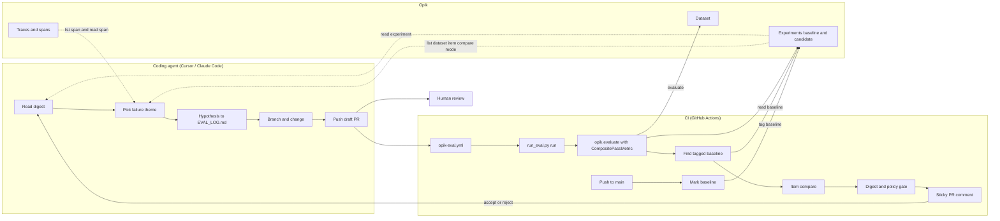

# Run Opik evaluations in CI and close the loop with a coding agent

## What this does

This guide is a small, working reference for two things: a GitHub Actions gate that runs an Opik
evaluation on every pull request and compares it to a tagged baseline, and a runbook that lets a
coding agent (Cursor or Claude Code) improve your app against that gate, one hypothesis per
iteration. The example task is a deterministic toy, so everything runs without an LLM provider key.



### What is in the folder

The source lives at
[`guides/eval_in_ci`](https://github.com/comet-ml/opik-examples/tree/main/guides/eval_in_ci) in
opik-examples. Copy the folder to `examples/eval_in_ci/` in your repo and the workflow to
`.github/workflows/opik-eval.yml`; the paths in the workflow and the runbook assume those
destinations. If you put them elsewhere, adjust the paths in the workflow and in the runbook's
guard paths.

| File | Purpose |
|---|---|
| `run_eval.py` | CLI with three modes: `run` (evaluate, then compare to baseline), `digest` (compare a finished experiment) and `demo` (offline) |
| `eval_compare.py` | Item compare, policy verdict, digest rendering (no network) |
| `opik_access.py` | SDK and REST layer: baseline lookup, experiment lookup, compare rows, URLs |
| `composite_metric.py` | `CompositePassMetric`: one pass/fail per item from several sub-metrics |
| `example_task.py` | Toy task (`scenario_agent`), sub-metrics, `build_metric`, and dataset seeding |
| `optimize_prompt.py` | Optional prompt optimizer, run by hand |
| `github/opik-eval.yml` | The GitHub Actions workflow |
| `agent/opik-eval-loop.md` | The coding-agent runbook, plus thin wrappers in `agent/cursor/` and `agent/claude/` |
| `run.sh` | Entry point for CI smoke runs: the offline demo, or a live run when credentials are set |
| `pyproject.toml` | Dependencies (`uv sync --group dev`; the optimizer is an optional extra) |
| `.env.example` | Variable names for local runs |
| `tests/` | Unit tests, no network: `uv run pytest` from this folder, or `pytest examples/eval_in_ci/tests` from your repo root |

## Prerequisites

- Python 3.12+ and [uv](https://docs.astral.sh/uv/). Install the dependencies (the optimizer is an
  optional extra):

  ```bash
  uv sync --group dev
  ```

- An Opik workspace. Create a service-account key if your deployment has them (Admin dashboard >
  Service accounts), otherwise a dedicated personal API key for CI.
- Two repository secrets: `OPIK_API_KEY` and `OPIK_WORKSPACE`. On a custom host also set
  `OPIK_URL_OVERRIDE` to `https://<host>/opik/api`; when it is unset the workflow defaults to
  `https://www.comet.com/opik/api`.

Tested with Opik SDK 2.2.113 against Opik server 2.2.x.

| Variable | Required | Used by |
|---|---|---|
| `OPIK_API_KEY` | yes | CLI, workflow, MCP |
| `OPIK_WORKSPACE` | yes | CLI, workflow, MCP |
| `OPIK_URL_OVERRIDE` | custom host only | CLI, workflow; `https://<host>/opik/api`; workflow defaults to Opik Cloud |
| `COMET_URL_OVERRIDE` | MCP only | MCP; `https://<host>` on a custom host |
| `OPENAI_API_KEY` | optimizer only | `optimize_prompt.py` |
| `OPIK_EXAMPLES_MODEL` | optimizer only | `optimize_prompt.py`; default `openai/gpt-4o-mini` |
| `AGENT_VERSION` | toy task only | `example_task.py`; `v1` by default, `v2` to show a regression |
| `OPIK_EVAL_GIT_SHA` | set by the workflow | experiment names; the PR head sha |
| `OPIK_EVAL_DEBUG` | no | CLI; print tracebacks on unexpected errors |

The Opik MCP server reads a different URL variable than the SDK: `COMET_URL_OVERRIDE=https://<host>`
instead of `OPIK_URL_OVERRIDE=https://<host>/opik/api`. `OPIK_WORKSPACE` is the path segment after
`/opik/` in the UI URL. `.env.example` lists the variables for local runs; you can also run
`opik configure`. The offline demo needs none of them.

## Running it

### Offline demo

Run from this folder (`guides/eval_in_ci` here, `examples/eval_in_ci` after copying it).

```bash
bash run.sh
# or: uv run python run_eval.py demo
```

No credentials and no Opik server. The demo compares the toy task at `AGENT_VERSION=v1` (the baseline)
with `v2` (the candidate) in-process and prints a digest with three kinds of content: the verdict
and pass rate (`0.75 -> 0.83`), the item lists (newly failing, newly passing, still failing), and
the per-metric means table. `AGENT_VERSION=v2` is what makes the toy both regress (`s05` starts
failing) and improve (`s03` and `s07` start passing). The last line explains that the demo exit
code is always 0; in CI use `run --fail-on-regression` so a hold fails the job.

### 10-minute setup for CI

1. Add the secrets from Prerequisites.
2. Copy `github/opik-eval.yml` to `.github/workflows/opik-eval.yml`. The workflow installs
   `opik==2.2.113`; bump it to the SDK version your server supports.
3. In the workflow, point `--task` at your task and `--dataset` at your dataset. The task is
   called as `task(**item)`, so it must accept the dataset fields as keyword arguments (or
   `**kwargs`). To try the toy first, seed its dataset once (without `OPIK_API_KEY` and
   `OPIK_WORKSPACE` in the shell the script only prints what it would insert):

   ```bash
   pip install "opik==2.2.113"
   python examples/eval_in_ci/example_task.py
   ```

4. Merge to `main` once. The push run uses `--mark-baseline`, which creates the first
   `baseline`-tagged experiment that later pull requests compare against.

To see a regression on the live toy, set `AGENT_VERSION: v2` in the eval step env on a PR.

### The run and digest commands

Local run, with the same flags the workflow uses:

```bash
uv run python run_eval.py run \
  --dataset eval-in-ci-example \
  --task example_task:scenario_agent \
  --fail-on-regression \
  --out digest.md --json digest.json
```

`run` flags: `--dataset`, `--task module:callable`, `--metric` (default
`example_task:build_metric`), `--trials`, `--mark-baseline`, `--pr`, `--baseline`,
`--pass-threshold`, `--policy`, `--fail-on-regression`, `--out`, `--json`, and an optional
`--project` lookup hint. Opik files experiments under the dataset's project, so `--project` only
helps look an experiment up by name.

Compare a finished experiment without re-running it with
`uv run python run_eval.py digest --experiment <name or id>`. `digest` flags: `--experiment`,
`--baseline`, `--pass-threshold`, `--policy`, `--fail-on-regression`, `--out`, `--json`, and an
optional `--project` lookup hint (same as for `run`).

`demo` flags: `--pass-threshold`, `--policy`, `--out`, `--json`.

### Reading the digest

`digest.md` is Markdown whose first line is exactly `<!-- opik-eval -->`. The workflow uses that
marker to update a single sticky comment on the pull request instead of adding a new one per push.
It shows the verdict, pass rate against the baseline, "Newly failing" and "Newly passing" items,
"Still failing" grouped by metric, per-metric means and a compare link, with a link to the worst
trace of each failing item. `digest.json` carries the same data for scripts.

The exit code is the contract:

| Code | Meaning |
|---|---|
| 0 | OK, or a baseline was created |
| 1 | Policy verdict hold or insufficient_evidence (only with `--fail-on-regression`) |
| 2 | Configuration or connection error, invalid policy file, or a crash in your task or metric |

The workflow captures the code, still uploads `digest.md` and `digest.json`, posts the comment, and
then fails the job with the original code in a final step that runs `if: always()`.

### Close the loop with a coding agent

`agent/opik-eval-loop.md` is the runbook. One iteration: pull the digest, diagnose with the Opik
MCP, pick one theme, write the hypothesis to `EVAL_LOG.md`, push an `eval/<theme>-<n>` branch and a
draft PR, read the CI result, accept or reject, log it. Install it as a Cursor rule
(`agent/cursor/opik-eval-loop.mdc`) or a Claude Code skill (`agent/claude/opik-eval-loop/`).

Deterministic pulls use `run_eval.py digest`; exploration goes through the Opik MCP server.

#### MCP setup (Cursor)

The Opik MCP server is `opik-mcp`, run with `uvx`; the variable names are in the Prerequisites
table. In Cursor's `mcp.json`:

```json
{
  "mcpServers": {
    "opik-mcp": {
      "type": "stdio",
      "command": "uvx",
      "args": ["opik-mcp@latest"],
      "env": {
        "COMET_URL_OVERRIDE": "https://<host>",
        "OPIK_WORKSPACE": "<workspace>",
        "OPIK_API_KEY": "<key>"
      }
    }
  }
}
```

Check the setup before opening Cursor, with the same three variables in your shell:

```bash
COMET_URL_OVERRIDE=https://<host> OPIK_WORKSPACE=<workspace> OPIK_API_KEY=<key> \
  uvx opik-mcp@latest --check
```

On comet.com the simpler option is the hosted server at `https://www.comet.com/opik/api/v1/mcp`
with browser sign-in and no key in a config file.

#### What changed in the MCP since the TypeScript server

- Five tools (`read`, `list`, `write`, `schema`, `read_skill`) instead of one tool per entity.
- Skills are served over `read_skill`.
- Every read and list answer prints its token size.
- Reads are layered: `list` for rows, `fields=` to pick columns, `read` for one full record.
- Experiments have a compare mode: `list('dataset_item', experiment_ids=[...])`.
- Command-line flags are no longer read. Old configs that pass `--apiKey`, `--apiUrl` or
  `--workspace` to `npx -y opik-mcp` now fail with a 401.
- The TypeScript server stops serving requests on 2026-11-15.

One open limit: a full `read('trace')` on an agent trace with 200+ spans is about 38k tokens, over
the 25k host cap. List the spans of the trace and read only the one or two the digest points at.
The runbook already follows this order.

### Quick win: optimize the prompt

`optimize_prompt.py` runs Opik's `MetaPromptOptimizer` on the same dataset, using the composite
metric as the objective, so a better prompt means more items passing every threshold. It is a local
helper and is not run in CI. It needs a provider key for the chosen model, for example
`OPENAI_API_KEY` for the default.

```bash
uv sync --extra optimizer
uv run python optimize_prompt.py --max-trials 3
```

Flags: `--dataset`, `--model` (default `$OPIK_EXAMPLES_MODEL`, else `openai/gpt-4o-mini`),
`--max-trials` (default 5) and `--prompt-file`.

Observed on the toy dataset after seeding `DEFAULT_SYSTEM_PROMPT` in `optimize_prompt.py` with the
actor naming rule and a partial maneuver list: 3 trials, `scenario_pass` 0.17 to 0.25. The toy ceiling is about 5 of 12
scenarios, because seven targets carry a `gap_m` value the input never states. In a real task,
state every target value in the input.

### Other CI systems

`run_eval.py` only needs Python, the three environment variables and the exit code. Port the
workflow by running the same command, uploading `digest.md`, posting it as a comment, and failing
the job on a non-zero code.

### Troubleshooting

- **Dataset not found.** `OPIK_WORKSPACE` or `OPIK_API_KEY` set in your shell overrides
  `~/.opik.config`. If they point at different workspaces, the dataset is not found. Check which
  workspace each one names.
- **No experiment found.** Several runs on one commit share the name `<branch>-<sha7>`. Pass the
  experiment id to `digest --experiment` instead.
- **Exit code 2.** A configuration, policy-file or connection problem, not a regression. Fix the
  setup. The agent runbook says to stop on it rather than treat it as a failed change.
- **Fork pull requests exit 2 by design.** GitHub gives fork PRs empty secrets and a read-only
  token, so the eval cannot reach Opik.

## How it works

### The composite metric pattern

An agent run usually has several things that must all be right. `CompositePassMetric` in
`composite_metric.py` takes several sub-metrics, each with a threshold, and reports one
`scenario_pass` score per item: 1 only when every sub-metric passes. The toy has three:
`actors_correct`, `maneuver_correct` and `parameters_correct`. The gate then reasons about
"items passing", which is easier to read and to act on than an average of unrelated scores. The
sub-metric scores stay on the experiment, so the digest can group failures by metric.

To use your own metrics, write a zero-argument function that returns your metric and pass it as
`--metric module:callable`.

### How baselines work

- On a push to `main` the workflow passes `--mark-baseline`. The experiment gets the `baseline`
  tag after the run finishes successfully, so a crashed run never becomes the baseline. The digest
  reports `baseline_created`; no comparison is made.
- On a pull request, the baseline is the newest experiment on the same dataset with an exact
  `baseline` tag. Override it with `--baseline NAME_OR_ID`. The digest names the baseline on its
  second line; with no baseline it reports `no_baseline` (exit 0).
- Experiment names are `<branch>-<sha7>`, where sha7 is the PR head commit (the workflow passes
  it as `OPIK_EVAL_GIT_SHA`). The PR comment header carries the exact experiment name. Repeated
  runs on one commit share a name, and `digest --experiment NAME` resolves the newest. Pass the
  experiment id to read an older run.
- `--trials N` (default 1) runs each item N times. An item passes only if all N trials pass, which
  matches the backend execution policy. `--pass-threshold K` relaxes that to K of N, and the
  digest then prints "K of N trials (differs from UI)".

### Policy file

Put `opik-release-policy.yaml` at the repo root or in `.opik/`, or pass `--policy PATH`. The keys
this gate reads:

| Key | Meaning | Default |
|---|---|---|
| `min_items` | Fewer items than this gives `insufficient_evidence` | 10 |
| `max_regressions` | Items that passed in the baseline and fail now | 0 |
| `pass_rate` | `not_below_baseline`, or a number from 0 to 1 | `not_below_baseline` |
| `flaky_policy` | `exclude` or `count` flaky items | `exclude` |

Other `opik-verify` keys are accepted and ignored. Unknown keys are an error (exit 2). The policy
file is read with PyYAML, which `pyproject.toml` and the workflow's `pip install` both declare.

### Guardrails

- The agent never edits the eval definition. The workflow guard fails a PR from an `eval/*` branch
  that touches `examples/eval_in_ci/composite_metric.py`, `examples/eval_in_ci/example_task.py`,
  `examples/eval_in_ci/eval_compare.py`, `examples/eval_in_ci/run_eval.py`,
  `examples/eval_in_ci/opik_access.py`, `.github/workflows/opik-eval.yml`,
  `opik-release-policy.yaml` or `.opik/**`.
- The guard only covers `eval/*` branches. Add a CODEOWNERS entry for those paths so a human
  reviews every change to them. On `pull_request`, GitHub runs the PR's own copy of the workflow,
  so only CODEOWNERS with required review or branch protection can protect the workflow file
  itself.
- The agent never lowers a threshold, drops dataset items or loosens the policy to pass a run.
- Iterate on a dev dataset. Run a held-out dataset only on candidates already accepted on dev.
- The agent never merges. Accepted changes stay draft PRs for a human.
- The agent stops at `MAX_ITERATIONS` (default 5).

### Crawl, walk, run

1. Crawl: the CI gate with a baseline, run by humans. Merge when the digest is green.
2. Walk: the coding-agent loop on `eval/*` branches, with a human reviewing every draft PR.
3. Run: an unattended driver (for example a scheduled `claude -p` or a Cursor background agent)
   that runs the loop overnight. This is not built here.


Real traffic and acceptance decisions become new dataset items, which sharpen the objective, which
makes the loop's changes better.

### FAQ

**Trials and judge noise.** If a metric uses an LLM judge, one trial per item is noisy. Use
`--trials 3`. Items that pass only some trials are flaky and follow `flaky_policy`.

**Small datasets and overfitting.** With 20 items an agent can overfit by fixing individual
items. Keep a held-out dataset, run it only on accepted candidates, and set `min_items` so thin
runs report `insufficient_evidence` instead of passing.

**Test Suites.** If you want pass/fail per item defined natively in Opik, Test Suites are the
built-in path. This kit keeps the pass rule in code so the gate does not depend on them.

**Nesting an out-of-process agent trace.** If your agent runs in another process, pass the trace
context through so its spans land under the experiment trace. In the task:

```python
from opik import opik_context


def my_task(question, **_):
    headers = opik_context.get_distributed_trace_headers()
    return call_remote_agent(question, headers)  # send headers with the request
```

In the remote process, accept them on the `@track`-decorated entry point:

```python
import opik


@opik.track
def agent_entry(question, opik_distributed_trace_headers=None): ...


# call: agent_entry(question, opik_distributed_trace_headers=headers)
# before the process exits:
opik.flush_tracker()
```

Two caveats: the remote process must use the same project name as the dataset's project, and it
must call `opik.flush_tracker()` before exiting or spans can be lost. Details:
`/tracing/advanced/log_distributed_traces` in the Opik docs.
