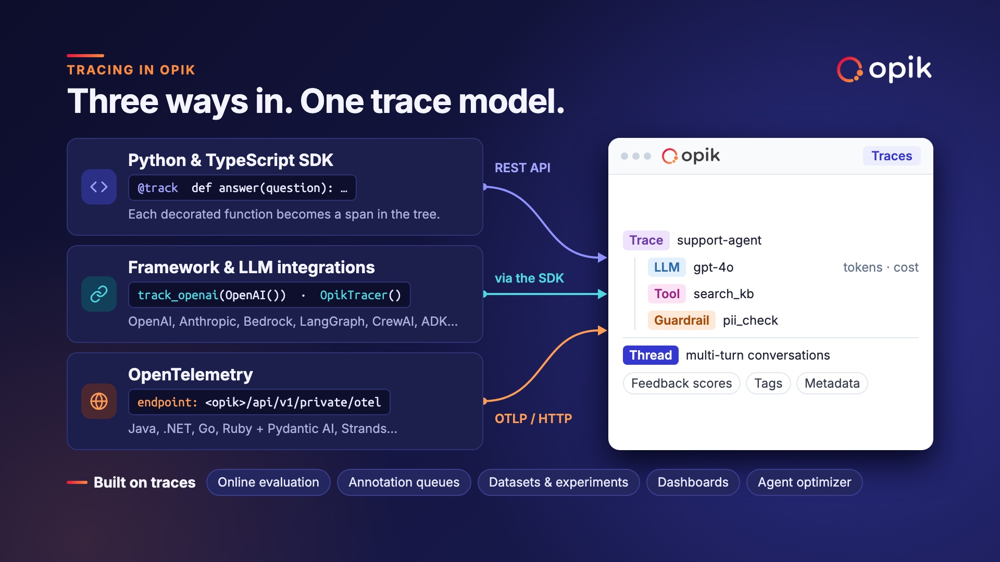

# Three ways to trace

Log the same small agent flow to Opik three ways (the Python SDK, an LLM integration and OpenTelemetry) and see that they all land as the same trace model.



## What this does

Tracing is the foundation everything else in Opik builds on: online evaluation, annotation queues, datasets and experiments, dashboards and the optimizer all read traces. There are three ways to produce one, and teams often aren't sure which fits. This notebook runs one support-agent flow through each path, tags the results `sdk`, `integration` and `otel`, and puts them side by side in one project so you can compare them in the UI:

1. **Python SDK.** `@track` on your own functions, with `opik_context` adding the model, token usage and cost to a simulated LLM step.
2. **Integration.** `track_anthropic` wraps the Anthropic client, nested under a `@track` function. Two chat turns share a `thread_id`, so they show up as one conversation under **Threads**.
3. **OpenTelemetry.** Plain OTel spans exported over OTLP/HTTP to Opik's endpoint, with no Opik SDK on the sending side. Opik types the spans from the `gen_ai.*` attributes.

## Prerequisites

```bash
uv sync    # or: pip install opik anthropic opentelemetry-sdk opentelemetry-exporter-otlp-proto-http
```

| Variable | Description |
|---|---|
| `OPIK_API_KEY` | Opik API key. If it's unset, the notebook runs `opik.configure()`, which prompts for it |
| `OPIK_WORKSPACE` | Opik workspace name |
| `OPIK_URL_OVERRIDE` | Optional; defaults to `https://www.comet.com/opik/api` |
| `ANTHROPIC_API_KEY` | Used by cell 2 only. If it's unset, the notebook prompts for it |
| `OPIK_PROJECT_NAME` | Optional; defaults to `tracing-three-ways` |
| `OPIK_EXAMPLES_MODEL` | Optional Anthropic model, as `anthropic/<model>`; defaults to `anthropic/claude-haiku-5-5` |

The notebook logs real traces, so it needs Opik credentials and has no dry-run.

## Running it

```bash
uv sync
uv run --with jupyter jupyter lab
```

Then open `tracing_three_ways.ipynb` and run the cells top to bottom.

[](https://colab.research.google.com/github/comet-ml/opik-examples/blob/main/guides/tracing_three_ways/tracing_three_ways.ipynb)

## How it works

- **SDK.** `support_agent` is the trace. It calls `search_kb` (`type="tool"`) and `generate_answer` (`type="llm"`), which become its child spans. `opik_context.update_current_span` sets `model`, `provider` and `usage` on the LLM span, and Opik computes the cost from its price list.
- **Integration.** `track_anthropic(anthropic.Anthropic())` logs each `messages.create` call as an `llm` span with tokens and cost. Because integrations are built on the SDK, the span nests under the `@track`-decorated `chat_turn`. `opik_context.update_current_trace(thread_id=...)` groups the turns into a thread.
- **OpenTelemetry.** The cell builds an `OTLPSpanExporter` pointed at `<opik-url>/v1/private/otel/v1/traces`. It reads the URL and API key from your Opik config and sends the `Authorization`, `Comet-Workspace` and `projectName` headers. It then emits a root span with two children. `gen_ai.request.model` and `gen_ai.usage.*` make the `llm` span; `gen_ai.tool.call.arguments`/`result` make the `tool` span. The `input`, `output` and `opik.tags` attributes map onto the trace fields. In your own app you would usually set `OTEL_EXPORTER_OTLP_ENDPOINT` and `OTEL_EXPORTER_OTLP_HEADERS` instead, and let an instrumentation library emit the spans.
